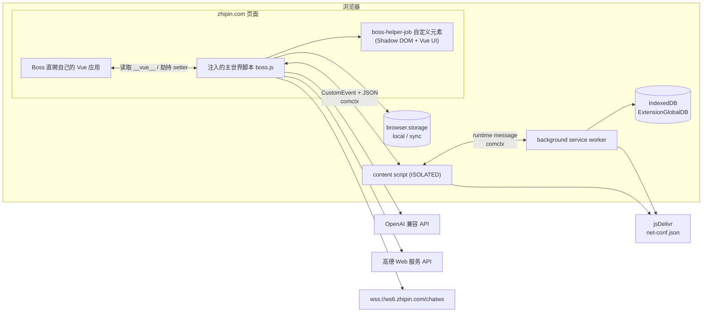

# 01 · 项目概览

## 1. 项目是什么

boss-helper-plus（BossHelper Plus，中文名“Boss直聘助手”）是一个**浏览器扩展**，运行在 `zhipin.com` 页面中，用于辅助 Boss 直聘求职者完成：

> 本项目是基于 [Ocyss/boss-helper](https://github.com/Ocyss/boss-helper) 的衍生改造版本，当前版本 `0.0.2`，版本号重新开始；代码基线为上游 `0.5.2.2`。

- 批量筛选职位
- 批量投递简历（发起沟通）
- 自动发送自定义或 AI 生成的招呼语
- 统计投递结果、记录日志
- 在页面内提供一套与原生页面融合的增强 UI

它不是后端服务，也没有自建服务器：所有配置、统计、日志、图片都保存在浏览器扩展存储或 IndexedDB 中；AI 请求由页面直接发往用户配置的 OpenAI 兼容接口；聊天消息通过 Boss 直聘自己的 WebSocket/MQTT 通道发送。

> 项目定位是“减少投递简历的麻烦、提高投递效率”，仓库根目录 `README.md` 也明确提示：仅供学习交流、禁止商用，使用自动化存在黑号/封号/降权风险。

## 2. 版本与规模

| 项目                | 值                                                                                                      |
| ------------------- | ------------------------------------------------------------------------------------------------------- |
| `package.json` 版本 | `0.0.2`（衍生版本，版本号重新开始）                                                                     |
| 上游代码基线        | [Ocyss/boss-helper](https://github.com/Ocyss/boss-helper) `0.5.2.2`                                     |
| 扩展显示名          | `boss-helper-plus`（BossHelper Plus）                                                                   |
| 扩展标识            | 包名/扩展名与上游区分；Chrome/Edge 不复用上游 key；Firefox 使用新 Gecko ID                              |
| 默认语言            | `zh_CN`（另有 `en` 语言包）                                                                             |
| 源码规模            | `src/` 下约 76 个 `.ts/.tsx/.vue/.css` 文件、约 1.04 万行（不含 885 KB 的第三方 SDK 副本）              |
| 主要语言            | TypeScript、Vue SFC、少量 SCSS/CSS                                                                      |
| 许可证              | MIT                                                                                                     |
| 发布渠道            | 本项目暂未上架商店，使用 GitHub Releases；原项目仍在 Chrome Web Store、Edge Add-ons、Firefox AMO 等渠道 |

## 3. 功能地图

| 能力                                    | 入口/实现                                                                  | 状态                                                                                                   |
| --------------------------------------- | -------------------------------------------------------------------------- | ------------------------------------------------------------------------------------------------------ |
| 批量投递、自动翻页                      | `src/entrypoints/boss/delivery.ts`、`src/composables/useApplying/index.ts` | 已实现                                                                                                 |
| 岗位名/公司名/工作内容/HR 职位/地址筛选 | `src/composables/useApplying/handles.ts`                                   | 已实现                                                                                                 |
| 薪资、公司规模范围筛选（严格/宽松）     | `handles.ts` + `useApplying/utils.ts`                                      | 已实现                                                                                                 |
| 活跃度、猎头、金牌面试官、已沟通过滤    | `handles.ts`、`delivery.ts`                                                | 已实现                                                                                                 |
| 相同公司/相同 HR 去重                   | `handles.ts`、`requests.ts`                                                | 已实现，但键的选择与命名不一致，见 [11-已知限制与风险.md](./11-已知限制与风险.md#3-代码层面的已知问题) |
| 高德地图直线/驾车/步行距离与时间筛选    | `handles.ts`、`src/utils/amap.ts`                                          | 已实现，需要用户自备高德 Key                                                                           |
| AI 筛选（打分）                         | `handles.ts`、`src/composables/useModel/chatModel.ts`                      | 已实现，投递前执行，评分写入日志                                                                       |
| AI 招呼语                               | `handles.ts`、`chatModel.ts`                                               | 已实现                                                                                                 |
| AI 自动回复聊天                         | `src/entrypoints/boss/autoReply.ts`、`chatModel.ts`                        | 已实现（监听 MQTT 消息 → 生成回复 → 发送，单岗位最多 10 条）                                           |
| 自定义招呼语（文本/图片、变量模板）     | `handles.ts`、`CustomGreeting.vue`                                         | 已实现                                                                                                 |
| 多 AI 模型管理与测试                    | `src/components/AI/*`、`src/composables/useModel/*`                        | 已实现                                                                                                 |
| 投递统计、按日历史                      | `src/composables/useStatistics.ts`、`Statistics.vue`                       | 已实现                                                                                                 |
| 日志面板                                | `src/composables/useLogs.ts`、`Logs.vue`                                   | 已实现，投递 / AI 调用 / 系统消息三类，本地持久化                                                      |
| 配置预设、导入导出                      | `src/composables/conf/index.ts`                                            | 已实现                                                                                                 |
| 配置自动保存                            | `Config.vue`、`Resume.vue`                                                 | 已实现，改动防抖 800ms 落盘                                                                            |
| 面板岗位搜索                            | `src/composables/useBossJobSearch.ts`、`Search.vue`                        | 已实现，调用 Boss 搜索接口，结果只进面板                                                               |
| 岗位列表虚拟滚动 + 下拉加载             | `JobTable.vue`                                                             | 已实现，只渲染可视区域，滚到底自动加载                                                                 |
| 配置过滤作用于面板列表                  | `src/composables/useJobMatching.ts`、`JobTable.vue`                        | 已实现，公司名/岗位名/工作内容/HR/地址/薪资/规模/活跃度/猎头/好友                                      |
| 简历抓取与候选人摘要                    | `src/composables/useBossResume.ts`、`Resume.vue`                           | 已实现，摘要优先用于 AI 过滤                                                                           |
| 投递结果缓存复用                        | `usePipelineCache.ts`、`useApplying/index.ts`                              | 已接入：命中缓存的岗位直接跳过，日志标「缓存命中」                                                     |
| 多账号                                  | —                                                                          | 已废弃，改为“多配置预设”                                                                               |
| 暗黑模式适配                            | —                                                                          | 不再专门维护，建议使用 Dark Reader                                                                     |

## 4. 技术栈

| 层           | 技术                                                                 | 在项目中的用途                                                    |
| ------------ | -------------------------------------------------------------------- | ----------------------------------------------------------------- |
| 扩展框架     | **WXT 0.21**                                                         | 多浏览器构建、manifest 生成、content script 注入、HMR             |
| 视图         | **Vue 3.5** + `@vitejs/plugin-vue-jsx`                               | 页面内 UI、响应式状态                                             |
| UI 组件      | **shadcn-vue** + Reka UI + lucide-vue-next                           | 全部 UI 已迁移；不再依赖 Nuxt UI                                  |
| 页面 DOM     | Shadow DOM 宿主                                                      | 只向 `document.body` 追加扩展宿主，不修改 Boss 原有 DOM 结构      |
| 样式         | **Tailwind CSS 4** + `@tailwindcss/typography`                       | 原子化样式；通过 `vite-plugin-tailwind-shadowdom` 适配 Shadow DOM |
| AI           | **Vercel AI SDK 7** + `@ai-sdk/openai`                               | 统一的 OpenAI 兼容调用、流式输出、结构化 JSON                     |
| 实时消息     | **MQTT 5** + **protobufjs 8**                                        | 通过 `wss://ws6.zhipin.com/chatws` 发送聊天消息                   |
| 跨上下文调用 | **comctx 1.7**                                                       | 主世界 ↔ content script ↔ background 的 RPC/Proxy                 |
| 存储         | WXT `storage`（封装 `browser.storage`）+ **idb 8**                   | 配置、统计、缓存；聊天图片文件存 IndexedDB                        |
| 工具         | `partial-json`、`spark-md5`、`@vueuse/core`                          | 解析流式 JSON、文件 MD5、组合式工具                               |
| 日志 UI      | `src/composables/useLogs.ts` + `devlog-ui`（workspace 子模块）       | 结构化运行日志；`devlog-ui` 仍用于控制台调试日志                  |
| 构建/质量    | Node.js、npm、Vite 8、TypeScript、oxlint、oxfmt、husky + lint-staged | 安装、构建、类型检查、lint、格式化、提交钩子                      |

## 5. 运行形态



三个关键点：

1. **UI 不直接操作宿主 DOM**：扩展把 UI 挂到自定义元素 `boss-helper-job` 的 Shadow DOM 中，样式与页面隔离。
2. **数据来自页面运行时而非接口爬取**：脚本通过 `#wrap.__vue__` 和各列表容器的 `__vue__` 读取页面自身的 `jobList`、`pageVo`、`jobDetail`，并劫持属性 setter 以获得持续更新。
3. **主世界脚本没有扩展 API**：`boss.js` 运行在页面主世界，无法直接使用 `browser.storage`、`browser.notifications`。它通过 content script 暴露的代理访问存储、通知、跨域请求和图片库。

## 6. 快速开始

### 6.1 环境要求

- **Node.js 20+** 与 **npm**（仓库使用 `package-lock.json`，CI 使用 Node.js + npm）
- Git（需要初始化子模块）
- Chrome / Edge / Firefox 之一，用于加载未打包扩展

### 6.2 安装

```bash
git clone https://github.com/hollyxun/boss-helper.git
cd boss-helper
git submodule update --init --recursive   # 拉取 packages/devlog-ui
npm install                               # postinstall 会执行 node scripts/wxt-run.mjs prepare
```

> `packages/devlog-ui` 在 `.gitmodules` 中声明为子模块。若该目录为空，`devlog-ui` 的 import 会失败，构建也无法完成。

### 6.3 开发

```bash
npm run dev            # Chrome
npm run dev:edge   # Edge
npm run dev:firefox
```

`wxt.config.ts` 中设置了 `webExt.disabled: true`，因此开发模式不会自动拉起浏览器。请在浏览器扩展管理页打开“开发者模式”，加载 `.output/` 下对应的开发产物目录（以终端输出为准）。

### 6.4 构建与打包

```bash
npm run build       # 依次构建 chrome / firefox / edge
npm run zip         # 依次生成三个商店的 zip
npm run check       # vue-tsc 类型检查
npm run lint        # oxlint --type-aware
npm run fmt         # oxfmt
```

构建产物位于 `.output/`，目录命名由 `outDirTemplate: '{{browser}}-mv{{manifestVersion}}'` 决定，例如 `chrome-mv3`、`firefox-mv3`、`edge-mv3`。详见 [10-构建发布与兼容性.md](./10-构建发布与兼容性.md)。

## 7. 适用边界

**适合**

- 个人求职期间减少重复点击和重复填写招呼语
- 在本地可控范围内试验“规则筛选 + LLM 评估”的职位筛选方案
- 学习浏览器扩展的主世界注入、跨上下文 RPC、任务管线设计

**不适合**

- 商业用途、代运营、批量账号矩阵
- 要求 100% 稳定、无人值守的投递
- 对隐私极度敏感、不能接受 API Key 存在浏览器扩展存储中的场景

## 8. 版本历史

| 版本    | 主要变化                                                                                                                                                                                                                                                       |
| ------- | -------------------------------------------------------------------------------------------------------------------------------------------------------------------------------------------------------------------------------------------------------------- |
| `0.0.2` | 菜单改为 简历 / 筛选 / 配置 / AI / 日志；岗位列表虚拟滚动 + 下拉加载；配置过滤作用于面板列表；新增 AI 自动回复；日志模块重写（投递 / AI 调用 / 系统消息）；候选人摘要；配置自动保存；移除外观配置与对话面板；修复筛选过期时间菜单、iframe 简历抓取丢模块等问题 |
| `0.0.1` | 基于上游 `0.5.2.2` 的衍生改造：迁移到 Node.js + npm，UI 全部迁移到 shadcn-vue，改为右侧吸附图标 + 抽屉                                                                                                                                                         |

## 9. 与仓库其他文档的关系

- 根目录 `README.md`：面向用户的简介、商店链接、TODO、鸣谢
- 根目录 `CONTRIBUTING.md`：贡献流程与代码规范，篇幅很长，强调小 PR、先讨论
- 根目录 `PRIVACY.md`：隐私说明
- `docs/README.md` 与 `docs/01~11`：本套源码分析文档，**全部为新增文件**

下一步建议阅读 [02-系统架构.md](./02-系统架构.md)。
