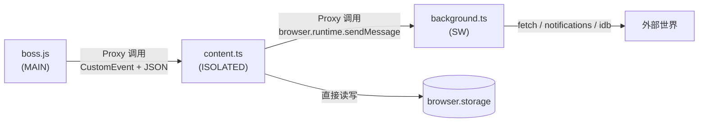
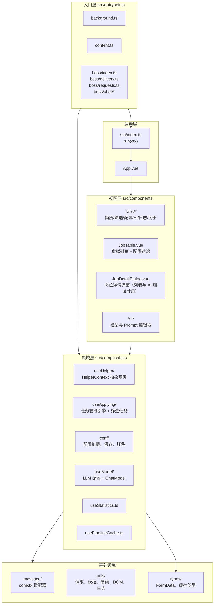
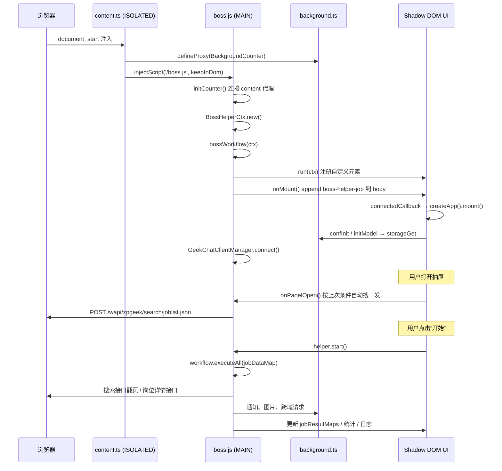
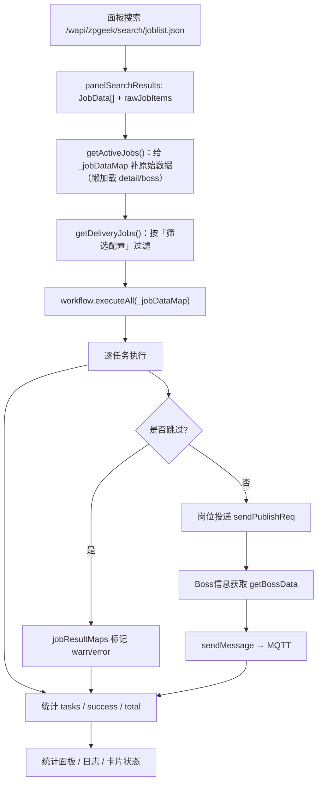

# 02 · 系统架构

## 1. 运行上下文

浏览器扩展至少涉及三个隔离的执行环境，boss-helper-plus 全部用到了：

| 上下文                         | 入口                                              | 能力                                                                        | 不能做什么                        |
| ------------------------------ | ------------------------------------------------- | --------------------------------------------------------------------------- | --------------------------------- |
| **页面主世界**（MAIN world）   | `src/entrypoints/boss/index.ts`，构建为 `boss.js` | 访问页面 `window`、`window._PAGE`、`window.Cookie`、`fetch`、WebSocket、DOM | 不能直接调用 `browser.*` 扩展 API |
| **内容脚本**（ISOLATED world） | `src/entrypoints/content.ts`                      | 使用 `browser.storage`、`browser.runtime`，可向页面注入脚本                 | 不能直接读取页面 JS 变量          |
| **后台 Service Worker**        | `src/entrypoints/background.ts`                   | 跨域 `fetch`、系统通知、IndexedDB、标签页消息                               | 无 DOM，生命周期由浏览器管理      |

三者通过 **comctx** 建立代理调用链：



具体消息格式、命名空间、序列化方式见 [07-消息与通信.md](./07-消息与通信.md)。

## 2. 代码分层



### 2.1 领域层的关键抽象

`HelperContext<C, T, S>`（`src/composables/useHelper/ctx.ts`）是一个抽象基类，定义了“某个招聘站点适配器”必须提供的能力：

- 数据：`jobMaps`、`jobResultMaps`、`currentJob`
- 配置与模型：`conf`、`models`、`chatModel`、`statistics`
- 工作流：`workflow`、`start/stop/reset`
- 站点相关：`uid`、`userInfo`、`key`、`label`、`getActiveJobs`、`loadMoreActiveJobs`、`onMount`、`onPanelOpen`、`sendMessage`、`getConfigItems`
- 通知：`notification(msg, opt)`，页面不可见时发系统通知，同时始终弹 Toast

`BossHelperCtx`（`src/entrypoints/boss/index.ts`）是唯一实现，`T = BoosJobData`（Boss 原始数据），`S = {}`（工作流状态）。

这种设计意味着：**要适配第二个招聘站点，需要新增一个 `HelperContext` 子类、一个入口脚本和一套任务定义**，理论上不需要改 UI 层与工作流引擎。不过当前 UI 中仍有 `boss` 专属假设（如 `window._PAGE`、CSS 选择器），实际复用成本不低。

### 2.2 任务管线

投递流程不是一串硬编码的 `if/else`，而是一条由 `Task` 组成的管线：

```text
已沟通 → 相同公司 → 相同HR → 岗位名 → 公司名 → 薪资 → 公司规模 → 猎头
→ 岗位详情获取 → 活跃度 → HR职位 → 工作地址 → 好友状态 → 工作内容
→ 金牌面试官 → 高德地图 → AI 过滤 → 岗位投递 → Boss信息获取 → 自定义招呼语 / AI招呼语 / AI 自动回复
```

每个任务可以：

- 在“构建期”读取配置，决定自己是否启用（返回 `undefined` 即禁用）
- 有一个或多个依赖，引擎据此拓扑排序
- 返回 `TaskResult`：`isSkip`、`status`、`reason`、`msg`
- 注册 `before` / `after` 钩子
- 在整轮结束时执行 `onEnd`

引擎、状态机、任务表与筛选语义全部在 [04-投递工作流.md](./04-投递工作流.md) 展开。

## 3. 关键设计决策

### 3.1 Shadow DOM 隔离 UI

`src/index.ts` 用 `customElements.define` 注册一个自定义元素（扩展重载 / 脚本重复注入时注册表已有同名标签，会按 `boss-helper-job-2`、`boss-helper-job-3`… 递增取一个空闲标签重新注册，由新实例接管）：

- `boss-helper-job`：右侧吸附图标 + shadcn-vue `Sheet` 抽屉（内部是左侧菜单 + 右侧内容区 + 底部按钮，不再有独立对话面板）

挂载时：

1. `root.attachShadow({ mode: 'open' })`
2. 把 `src/assets/main.css?inline` 的样式文本塞进 shadow root
3. 创建 `#app-root`
4. `createApp(App).provide(HelperKey, ctx).mount(container)`

好处是宿主页面的全局样式不会污染扩展 UI；代价是：

- Tailwind 需要 `vite-plugin-tailwind-shadowdom` 处理
- shadcn-vue 的弹层默认挂到 `document.body`，会逃出 Shadow DOM。因此 `src/index.ts` 通过 `PortalKey` 注入 `#app-root`，`DialogContent`、`DropdownMenuContent`、`PopoverContent`、`SelectContent`、`SheetContent`、`TooltipContent` 这 6 个弹层都 portal 到 shadow 内
- 事件、样式、`document.querySelector` 都需要额外注意边界

`disconnectedCallback` 中调用 `app.unmount()`，这是“完美卸载”的关键，否则宿主元素被移除后旧 Vue 实例可能残留。

### 3.2 不劫持宿主页面：只调 Boss 自己的接口

Boss 直聘页面是 SPA，职位数据在页面 Vue 组件的 data 里。早期版本通过 `#wrap.__vue__` 和列表容器的 `__vue__` 劫持页面组件的 `jobList` / `jobDetail` setter，并取出 `clickJobCardAction` 模拟点击卡片补详情。这套桥接（`src/composables/useVue.ts`）以及往宿主 Vue Router 注入的 `afterHooks` **已全部删除**：

| 数据     | 来源                                                                                                        |
| -------- | ----------------------------------------------------------------------------------------------------------- |
| 岗位列表 | `/wapi/zpgeek/search/joblist.json`（`searchJobs`）                                                          |
| 岗位详情 | `/wapi/zpgeek/job/detail.json`（`fetchJobDetail`，`securityId` + `lid` 来自搜索结果的原始项 `rawJobItems`） |
| 投递     | `/wapi/zpgeek/friend/add.json` 等                                                                           |
| 消息     | 扩展自建的 MQTT 长连接 `wss://ws6.zhipin.com/chatws`                                                        |

页面只剩两处只读用途：`window._PAGE`（uid / token）和 `window.Cookie.get('bst')`（请求头 `Zp_token`）。扩展不读页面 Vue 实例、不模拟点击、不驱动页面搜索或翻页。

代价：详情接口失败时没有「点页面卡片再试一次」的兜底，该岗位直接判 `error`，依赖详情的 10 个管线任务一并跳过。

### 3.3 主世界脚本通过“脚本元素上的 CustomEvent”通信

`content.ts` 在 `document_start` 注入 `boss.js`：

```ts
await injectScript('/boss.js', {
  keepInDom: true,
  modifyScript(script) {
    provideContentCounter(new ProvideContentScriptAdapter(script))
  },
})
```

`ProvideContentScriptAdapter` 把消息序列化成 JSON 字符串，派发到 `<script>` 元素的 `_boss-helper-message_` 事件上；主世界侧用同一个适配器监听。这样：

- 不污染 `window` 全局命名空间
- 避免主世界与隔离世界对象不能直接传递的问题
- Firefox 下对 `cloneInto` 有兼容分支（`contentScriptShare.ts` 中有声明与注释）

### 3.4 配置是模块级单例 + 响应式对象

`src/composables/conf/index.ts` 在模块加载时创建：

```ts
const formData: FormData = reactive(defaultFormData)
const formDataPreset = ref('default')
const formDataPresets = ref([...])
```

`useConf()` 每次调用返回一组闭包函数，但操作的是同一份 `formData`。`App.vue` 挂载时调用 `conf.confInit()` 从存储加载并用 `deepmerge(defaultFormData, from)` 补齐默认值；配置页 / 简历页的改动会防抖 800ms 调用 `confSaving(true)` 自动写回存储，「保存配置」按钮只是额外立即保存一次。

这意味着：

- 组件之间无需额外状态库即可共享配置
- **配置变更会自动持久化**：配置页 / 简历页改动后防抖 800ms 调用 `confSaving(true)` 静默保存；导入、推荐、清空、AI 分析结果会立即落盘
- 工作流在 `executeAll` 开始时才 `rebuild()`，运行中修改配置通常不会影响当前轮

### 3.5 懒加载依赖与 `DependencyMissingError`

职位详情不是列表接口返回的，而是单独调用 `fetchJobDetail`（`/wapi/zpgeek/job/detail.json`，`securityId` + `lid` 来自搜索结果的原始项）拉取。为了让依赖详情的筛选任务不必手动排序，项目定义了：

```ts
createLazyObject<T>('岗位详情获取')
```

它是一个 `Proxy`：未初始化时访问任意属性会抛 `DependencyMissingError(taskId)`；工作流捕获后，先执行该依赖任务，再重试当前任务。这属于“按需拉取 + 自动补依赖”的设计。

不过在当前 `bossWorkflow` 中，依赖详情的任务已经显式声明 `deps: ['岗位详情获取']`，所以这条机制更像兜底。

### 3.6 单页应用内的挂载与卸载

宿主的摘除与创建都在 `run()` 里完成（先 `removeOldHosts()` 摘旧宿主、再 `document.body.appendChild` 建新宿主），`BossHelperCtx.onMount()` 只负责绑定数据：

1. 复用 `run()` 已建在 body 里的宿主：优先取 `[data-boss-helper-host]` 引用，取不到才补建 `<boss-helper-job>`
2. 初始化网络配置 `initNetConf()`
3. 连接聊天 WebSocket（`GeekChatClientManager.connect()`）
4. 挂载 AI 自动回复服务（`AutoReplyService.attach()`）

`onMount()` 仅在 `run()` 里被调用一次。早期往宿主 Vue Router 注入的 `afterHooks` 已删除，站内路由切换不再重挂面板——面板（宿主元素 + Shadow DOM）常驻 `document.body`，跨 Boss 站内页面切换不会重建。

## 4. 生命周期时序



## 5. 一次投递的数据流



## 6. 状态归属

| 状态                           | 位置                                | 生命周期     | 持久化                                                                   |
| ------------------------------ | ----------------------------------- | ------------ | ------------------------------------------------------------------------ |
| `formData`                     | `conf/index.ts` 模块级 `reactive`   | 整个页面会话 | 自动保存（防抖 800ms）到 `local:web-geek-job-FormData*`                  |
| `modelData`                    | `useModel/index.ts` 模块级 `ref`    | 整个页面会话 | 手动 `saveModel`，`sync:conf-model`                                      |
| `todayData` / `statisticsData` | `useStatistics()`，每个 Helper 一份 | Helper 实例  | `todayData` 节流写 `local:web-geek-job-Today`                            |
| `jobMaps` / `jobResultMaps`    | `BossHelperCtx` / `HelperContext`   | 当前页面会话 | 否                                                                       |
| `panelSearchResults`           | `useBossJobSearch.ts` 模块级 `ref`  | 当前页面会话 | 否（岗位列表的唯一来源，刷新即空，靠抽屉打开时自动搜一发补回来）         |
| `logEntries`                   | `useLogs.ts` 模块级 `ref`           | 整个页面会话 | `localStorage` 保留最近 200 条                                           |
| `lastBossResume`               | `useBossResume.ts` 模块级 `ref`     | 整个页面会话 | `localStorage`（24 小时内有效）                                          |
| `workflow`                     | `BossHelperCtx.workflow`            | 当前页面会话 | 否                                                                       |
| 管道缓存                       | `PipelineCacheManager` 单例         | 整个页面会话 | `local:pipeline-cache`（已接入，默认关闭，由配置页 `useCache` 开关控制） |
| 聊天图片                       | background `IndexedDB`              | 扩展生命周期 | `ExtensionGlobalDB/images`                                               |
| 相同公司/HR 集合               | `browser.storage.local`             | 跨会话       | `local:sameCompany`、`local:sameHr`                                      |

## 7. UI 结构

`App.vue` 现在是一个 **右侧吸附图标 + 抽出式抽屉** 的外壳：

- 右侧边缘：固定定位的 shadcn-vue `Button`，点击打开抽屉
- 抽屉：shadcn-vue `Sheet` / `SheetContent`，从右侧滑出，不占用原页面布局
- 顶部：标题、版本按钮（有新版本时显示圆点）
- 网络公告：`netConf.notification` 中 `type === 'alert'` 的条目
- 左侧菜单（不是 Tabs）：简历 / 筛选 / 配置 / AI / 日志 / 关于，内容区随菜单切换
- 底部：今日 x/上限、处理 current/total 进度，以及反馈、帮助模式按钮（开始 / 暂停 / 重置筛选在「筛选」页搜索区的 actions 槽，不在底部）
- 关闭方式：右上角 X、Esc、双击蒙层；点蒙层不会误关
- 帮助模式：鼠标移动时用 `document.elementFromPoint` 找到最近的 `[data-help]`，用一个固定定位的 `.overlay-box` 高亮并显示 Tooltip

抽屉内「筛选」页是核心工作区：上半部分是按条件调用 Boss 搜索接口的表单，下半部分是岗位列表（虚拟滚动 + 配置过滤 + 下拉加载）。AI 调用不再有独立对话面板，全部记录在「日志」页的 AI 调用分类里。

扩展不再搬运 Boss 原生的搜索框和筛选条件，也不再删除广告、侧栏、头部或列表节点。原生筛选继续由 Boss 页面自己管理；扩展的岗位列表来自 Boss 自己的搜索接口，页面只提供登录信息（`_PAGE` / `Cookie`），UI 全部放在自己的 Shadow DOM 抽屉里。

## 8. 并发与错误边界

- **投递是串行的**：`executeAll` 用 `for...of` 逐职位执行，职位之间 `delayDeliveryInterval`，翻页之间 `delayDeliveryPageNext`，开始前 `delayDeliveryStarts`。
- **停止是协作式的**：`status.value === 'stop'` 在任务间、延迟中、翻页前被检查；不会强杀正在进行的 `fetch`。
- **单个任务抛错会终止该职位的管线**，标记 `error`，然后继续下一个职位；整个 `executeAll` 的外层 `try/catch` 只处理循环级异常。
- **AI 请求失败会抛错**，因为没有为该任务配置重试，结果是该职位被标记为错误并跳过。
- **详情只走接口**：`fetchJobDetail` 拿不到就抛「岗位详情获取失败」，没有模拟点击兜底，该岗位的管线随即终止。
- **翻页只看搜索接口**：岗位列表只有面板搜索这一个来源，`loadMoreActiveJobs` 追加 `searchJobs(conditions, page + 1, true)`；`searchMeta.hasMore` 为 `false` 或条件丢失就不再翻，页面自身的翻页函数（`pageChangeAction` / `searchJobAction`）已经不再劫持。

这些行为共同决定了：**扩展不会无限重试，也不会在页面无法滚动时自动恢复**。相关限制见 [11-已知限制与风险.md](./11-已知限制与风险.md)。

## 9. 为什么没有引入 Pinia / Vuex

项目规模不大，状态分为两类：

1. 跨组件共享的配置：模块级 `reactive` + `useConf()` 闭包
2. 页面级运行状态：`BossHelperCtx` 实例，通过 Vue `provide/inject`（`HelperKey`）传给组件

因此不需要额外的状态库。代价是模块级单例较多，测试时不易隔离；这也是项目几乎没有单元测试的原因之一。

下一篇：[03-目录结构与模块.md](./03-目录结构与模块.md)。
