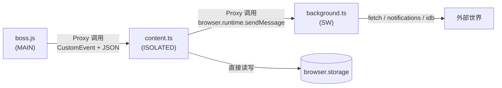
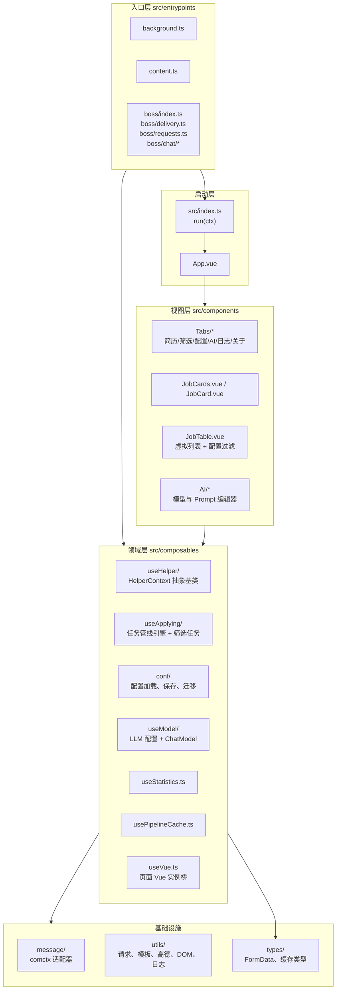
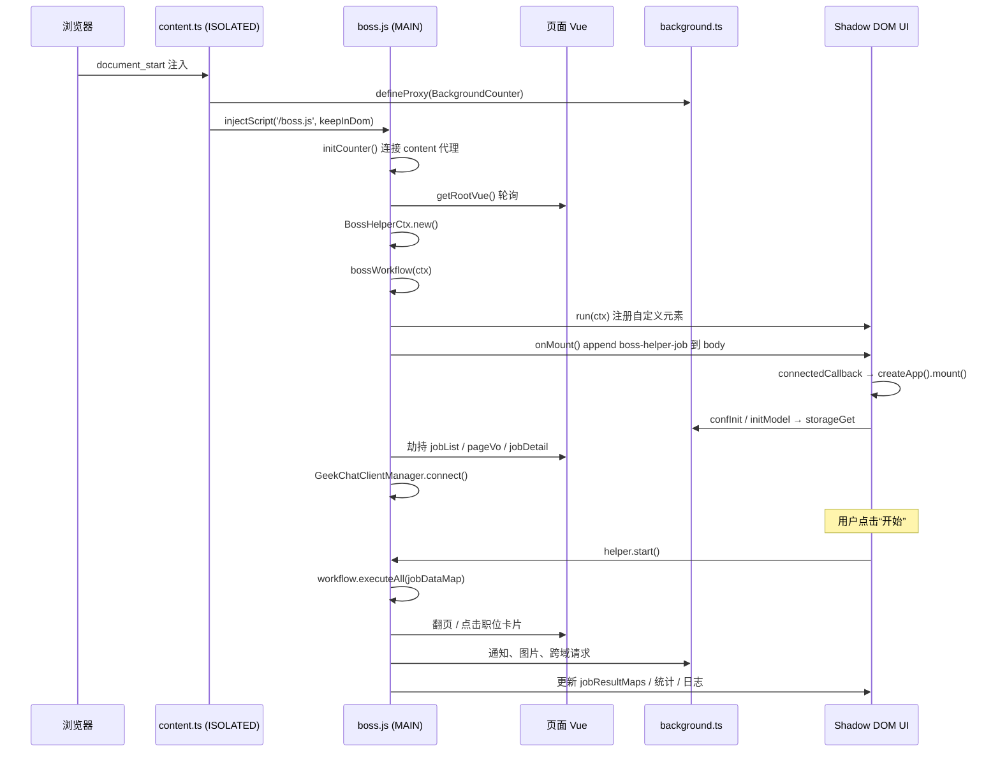
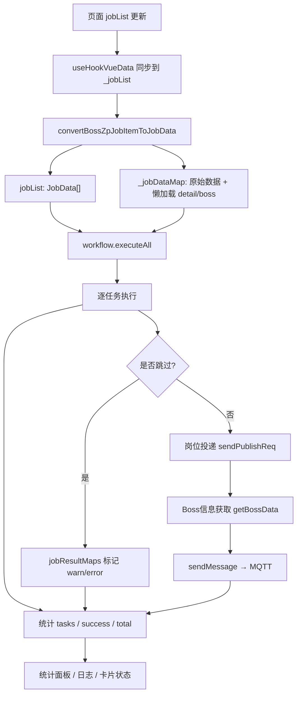

# 02 · 系统架构

## 1. 运行上下文

浏览器扩展至少涉及三个隔离的执行环境，boss-helper-plus 全部用到了：

| 上下文                         | 入口                                              | 能力                                                                                | 不能做什么                        |
| ------------------------------ | ------------------------------------------------- | ----------------------------------------------------------------------------------- | --------------------------------- |
| **页面主世界**（MAIN world）   | `src/entrypoints/boss/index.ts`，构建为 `boss.js` | 访问页面 `window`、`#wrap.__vue__`、`window._PAGE`、`window.Cookie`、WebSocket、DOM | 不能直接调用 `browser.*` 扩展 API |
| **内容脚本**（ISOLATED world） | `src/entrypoints/content.ts`                      | 使用 `browser.storage`、`browser.runtime`，可向页面注入脚本                         | 不能直接读取页面 JS 变量          |
| **后台 Service Worker**        | `src/entrypoints/background.ts`                   | 跨域 `fetch`、系统通知、IndexedDB、标签页消息                                       | 无 DOM，生命周期由浏览器管理      |

三者通过 **comctx** 建立代理调用链：



具体消息格式、命名空间、序列化方式见 [07-消息与通信.md](./07-消息与通信.md)。

## 2. 代码分层



### 2.1 领域层的关键抽象

`HelperContext<C, T, S>`（`src/composables/useHelper/ctx.ts`）是一个抽象基类，定义了“某个招聘站点适配器”必须提供的能力：

- 数据：`jobList`、`jobMaps`、`jobResultMaps`、`currentJob`
- 配置与模型：`conf`、`models`、`chatModel`、`statistics`
- 工作流：`workflow`、`start/stop/reset`
- 站点相关：`uid`、`userInfo`、`key`、`label`、`loadMoreJob`、`onMount`、`sendMessage`、`onJobCardClick`、`getConfigItems`
- 通知：`notification(msg, opt)`，页面不可见时发系统通知，同时始终弹 Toast

`BossHelperCtx`（`src/entrypoints/boss/index.ts`）是唯一实现，`T = BoosJobData`（Boss 原始数据），`S = {}`（工作流状态）。

这种设计意味着：**要适配第二个招聘站点，需要新增一个 `HelperContext` 子类、一个入口脚本和一套任务定义**，理论上不需要改 UI 层与工作流引擎。不过当前 UI 中仍有 `boss` 专属假设（如 `window._PAGE`、CSS 选择器），实际复用成本不低。

### 2.2 任务管线

投递流程不是一串硬编码的 `if/else`，而是一条由 `Task` 组成的管线：

```text
已沟通 → 相同公司 → 相同HR → 岗位名 → 公司名 → 薪资 → 公司规模 → 猎头
→ 岗位详情获取 → 活跃度 → HR职位 → 工作地址 → 好友状态 → 工作内容
→ 金牌面试官 → 高德地图 → AI 过滤 → 岗位投递 → Boss信息获取 → 自定义招呼语 / AI招呼语 / AI 自动回复
```

每个任务可以：

- 在“构建期”读取配置，决定自己是否启用（返回 `undefined` 即禁用）
- 有一个或多个依赖，引擎据此拓扑排序
- 返回 `TaskResult`：`isSkip`、`status`、`reason`、`msg`
- 注册 `before` / `after` 钩子
- 在整轮结束时执行 `onEnd`

引擎、状态机、任务表与筛选语义全部在 [04-投递工作流.md](./04-投递工作流.md) 展开。

## 3. 关键设计决策

### 3.1 Shadow DOM 隔离 UI

`src/index.ts` 用 `customElements.define` 注册了两个自定义元素：

- `boss-helper-job`：右侧吸附图标 + shadcn-vue `Sheet` 抽屉（内部是左侧菜单 + 右侧内容区 + 底部按钮，不再有独立对话面板）
- `boss-helper-menu`：头像菜单（当前入口未启用）

挂载时：

1. `root.attachShadow({ mode: 'open' })`
2. 把 `src/assets/main.css?inline` 的样式文本塞进 shadow root
3. 创建 `#app-root`
4. `createApp(App).provide(HelperKey, ctx).mount(container)`

好处是宿主页面的全局样式不会污染扩展 UI；代价是：

- Tailwind 需要 `vite-plugin-tailwind-shadowdom` 处理
- shadcn-vue 的 `DialogPortal` 默认挂到 `document.body`，会逃出 Shadow DOM。因此 `src/index.ts` 通过 `PortalKey` 注入 `#app-root`，`Modal`、`Slideover`、`SheetContent` 等弹层都 portal 到 shadow 内
- 事件、样式、`document.querySelector` 都需要额外注意边界

`disconnectedCallback` 中调用 `app.unmount()`，这是“完美卸载”的关键，否则路由切换后旧 Vue 实例可能残留。

### 3.2 借用页面自己的 Vue 实例，而不是爬 DOM

Boss 直聘页面是 SPA，职位数据在页面 Vue 组件的 data 里。扩展通过 `src/composables/useVue.ts` 建立桥接：

| 函数                                          | 作用                                                                                                                                            |
| --------------------------------------------- | ----------------------------------------------------------------------------------------------------------------------------------------------- |
| `getRootVue()`                                | 轮询 `#wrap.__vue__`，最多 20 秒，取得页面根 Vue 实例                                                                                           |
| `useHookVueData(selector, key, ref, update?)` | 找到 `selector` 元素的 `__vue__`，读取 `vue[key]`，并用 `Object.defineProperty` 劫持该属性的 setter；页面每次更新该属性，都会同步到扩展的 `ref` |
| `useHookVueFn(selector, key)`                 | 从页面 Vue 实例上取出一个方法（如 `pageChangeAction`、`clickJobCardAction`）                                                                    |

这依赖页面把 Vue 实例暴露在 DOM 元素的 `__vue__` 上（Vue 2 的常见行为）。一旦目标站点升级 Vue 3、移除 `__vue__`、改用 Proxy 或压缩属性名，这套桥接会整体失效。

`useHookVueData` 的 setter 劫持代码如下（简化）：

```ts
const originalSet = jobVue.__lookupSetter__(key)
Object.defineProperty(jobVue, key, {
  set(val) {
    data.value = val
    update?.(val)
    originalSet.call(this, val)
  },
})
```

因此职位列表变化、翻页、点击职位后的 `jobDetail` 变化，都能被扩展感知。

### 3.3 主世界脚本通过“脚本元素上的 CustomEvent”通信

`content.ts` 在 `document_start` 注入 `boss.js`：

```ts
await injectScript('/boss.js', {
  keepInDom: true,
  modifyScript(script) {
    provideContentCounter(new ProvideContentScriptAdapter(script))
  },
})
```

`ProvideContentScriptAdapter` 把消息序列化成 JSON 字符串，派发到 `<script>` 元素的 `_boss-helper-message_` 事件上；主世界侧用同一个适配器监听。这样：

- 不污染 `window` 全局命名空间
- 避免主世界与隔离世界对象不能直接传递的问题
- Firefox 下对 `cloneInto` 有兼容分支（`contentScriptShare.ts` 中有声明与注释）

### 3.4 配置是模块级单例 + 响应式对象

`src/composables/conf/index.ts` 在模块加载时创建：

```ts
const formData: FormData = reactive(defaultFormData)
const formDataPreset = ref('default')
const formDataPresets = ref([...])
```

`useConf()` 每次调用返回一组闭包函数，但操作的是同一份 `formData`。`App.vue` 挂载时调用 `conf.confInit()` 从存储加载并用 `deepmerge(defaultFormData, from)` 补齐默认值；用户点“保存配置”才写回存储。

这意味着：

- 组件之间无需额外状态库即可共享配置
- **配置变更会自动持久化**：配置页 / 简历页改动后防抖 800ms 调用 `confSaving(true)` 静默保存；导入、推荐、清空、AI 分析结果会立即落盘
- 工作流在 `executeAll` 开始时才 `rebuild()`，运行中修改配置通常不会影响当前轮

### 3.5 懒加载依赖与 `DependencyMissingError`

职位详情不是列表接口返回的，必须“点击职位卡片 → 页面请求详情 → 页面 `jobDetail` 更新”。为了让依赖详情的筛选任务不必手动排序，项目定义了：

```ts
createLazyObject<T>('岗位详情获取')
```

它是一个 `Proxy`：未初始化时访问任意属性会抛 `DependencyMissingError(taskId)`；工作流捕获后，先执行该依赖任务，再重试当前任务。这属于“按需拉取 + 自动补依赖”的设计。

不过在当前 `bossWorkflow` 中，依赖详情的任务已经显式声明 `deps: ['岗位详情获取']`，所以这条机制更像兜底。

### 3.6 单页应用内的挂载与卸载

`BossHelperCtx.onMount()` 的流程：

1. 若存在旧实例，`remove()` 触发 Vue 卸载
2. 创建 `<boss-helper-job>` 并 **append 到 `document.body`**（不再插入职位列表，避免占用页面布局）
3. 初始化分页、详情、点击卡片方法、职位列表
4. 初始化网络配置 `initNetConf()`
5. 连接聊天 WebSocket（`GeekChatClientManager.connect()`）

路由变化通过页面 Vue Router 的 `afterHooks` 触发：

```ts
bossHelpCtx.rootVue.$router.afterHooks.push((to) => {
  void bossHelpCtx.onMount()
})
```

这就是为什么切换 Boss 直聘站内页面后，扩展面板会重新挂载。

## 4. 生命周期时序



## 5. 一次投递的数据流



## 6. 状态归属

| 状态                                    | 位置                                 | 生命周期     | 持久化                                                  |
| --------------------------------------- | ------------------------------------ | ------------ | ------------------------------------------------------- |
| `formData`                              | `conf/index.ts` 模块级 `reactive`    | 整个页面会话 | 自动保存（防抖 800ms）到 `local:web-geek-job-FormData*` |
| `appearanceConf`                        | `conf/index.ts` 的 `useStorageAsync` | 整个扩展     | 自动，`sync:appearance-conf`（配置页已不再暴露入口）    |
| `modelData`                             | `useModel/index.ts` 模块级 `ref`     | 整个页面会话 | 手动 `saveModel`，`sync:conf-model`                     |
| `todayData` / `statisticsData`          | `useStatistics()`，每个 Helper 一份  | Helper 实例  | `todayData` 节流写 `local:web-geek-job-Today`           |
| `jobList` / `jobMaps` / `jobResultMaps` | `BossHelperCtx` / `HelperContext`    | 当前页面会话 | 否                                                      |
| `panelSearchResults`                    | `useBossJobSearch.ts` 模块级 `ref`   | 当前页面会话 | 否                                                      |
| `logEntries`                            | `useLogs.ts` 模块级 `ref`            | 整个页面会话 | `localStorage` 保留最近 200 条                          |
| `lastBossResume`                        | `useBossResume.ts` 模块级 `ref`      | 整个页面会话 | `localStorage`（24 小时内有效）                         |
| `workflow`                              | `BossHelperCtx.workflow`             | 当前页面会话 | 否                                                      |
| 管道缓存                                | `PipelineCacheManager` 单例          | 整个页面会话 | `local:pipeline-cache`（当前未接入）                    |
| 聊天图片                                | background `IndexedDB`               | 扩展生命周期 | `ExtensionGlobalDB/images`                              |
| 相同公司/HR 集合                        | `browser.storage.local`              | 跨会话       | `local:sameCompany`、`local:sameHr`                     |

## 7. UI 结构

`App.vue` 现在是一个 **右侧吸附图标 + 抽出式抽屉** 的外壳：

- 右侧边缘：固定定位的 shadcn-vue `Button`，点击打开抽屉
- 抽屉：shadcn-vue `Sheet` / `SheetContent`，从右侧滑出，不占用原页面布局
- 顶部：标题、版本按钮（有新版本时显示圆点）、今日投递数、当前页处理进度
- 网络公告：`netConf.notification` 中 `type === 'alert'` 的条目
- 左侧菜单（不是 Tabs）：简历 / 筛选 / 配置 / AI / 日志 / 关于，内容区随菜单切换
- 底部：开始 / 暂停 / 重置、反馈、帮助模式等按钮
- 关闭方式：右上角 X、Esc、双击蒙层；点蒙层不会误关
- 帮助模式：鼠标移动时用 `document.elementFromPoint` 找到最近的 `[data-help]`，用一个固定定位的 `.overlay-box` 高亮并显示 Tooltip

抽屉内「筛选」页是核心工作区：上半部分是按条件调用 Boss 搜索接口的表单，下半部分是岗位列表（虚拟滚动 + 配置过滤 + 下拉加载）。AI 调用不再有独立对话面板，全部记录在「日志」页的 AI 调用分类里。

扩展不再搬运 Boss 原生的搜索框和筛选条件，也不再删除广告、侧栏、头部或列表节点。原生筛选继续由 Boss 页面自己管理；扩展只负责读取页面 Vue 实例中的职位数据，并把 UI 放在自己的 Shadow DOM 抽屉里。

## 8. 并发与错误边界

- **投递是串行的**：`executeAll` 用 `for...of` 逐职位执行，职位之间 `delayDeliveryInterval`，翻页之间 `delayDeliveryPageNext`，开始前 `delayDeliveryStarts`。
- **停止是协作式的**：`status.value === 'stop'` 在任务间、延迟中、翻页前被检查；不会强杀正在进行的 `fetch`。
- **单个任务抛错会终止该职位的管线**，标记 `error`，然后继续下一个职位；整个 `executeAll` 的外层 `try/catch` 只处理循环级异常。
- **AI 请求失败会抛错**，因为没有为该任务配置重试，结果是该职位被标记为错误并跳过。
- **详情获取有 60 秒超时**：`onJobCardClick` 轮询 `_jobDetail`，超时抛 `bossZpDetailData获取超时`。
- **翻页有“内容无变化”检测**：`loadMoreJob` 比较翻页前后的列表长度和首个职位 ID，若未变化则判定无法继续。

这些行为共同决定了：**扩展不会无限重试，也不会在页面无法滚动时自动恢复**。相关限制见 [11-已知限制与风险.md](./11-已知限制与风险.md)。

## 9. 为什么没有引入 Pinia / Vuex

项目规模不大，状态分为两类：

1. 跨组件共享的配置：模块级 `reactive` + `useConf()` 闭包
2. 页面级运行状态：`BossHelperCtx` 实例，通过 Vue `provide/inject`（`HelperKey`）传给组件

因此不需要额外的状态库。代价是模块级单例较多，测试时不易隔离；这也是项目几乎没有单元测试的原因之一。

下一篇：[03-目录结构与模块.md](./03-目录结构与模块.md)。
