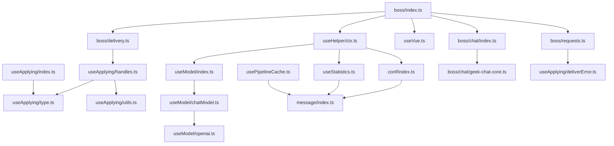

# 03 · 目录结构与模块

## 1. 仓库总体结构

```text
boss-helper/
├─ src/                     # 扩展源码
├─ public/                  # 静态资源：图标、_locales 语言包
├─ packages/
│  └─ devlog-ui/            # Git 子模块：日志 UI 库（未初始化时为空）
├─ docs/                    # 原有截图 img/ + 本套新增分析文档
├─ scripts/
│  ├─ submit.sh             # 通过 wxt submit 发布到商店
│  └─ wxt-run.mjs           # Node 下的 WXT prepare/build/zip 包装器
├─ .github/workflows/
│  └─ main.yml              # Node.js 构建 + GitHub Release
├─ .husky/pre-commit        # npx lint-staged
├─ .npmrc                   # legacy-peer-deps 配置
├─ wxt.config.ts            # WXT / Vite / manifest / Nuxt UI 配置
├─ package.json             # 脚本与依赖
├─ package-lock.json        # npm 锁文件
├─ tsconfig.json            # 继承 .wxt/tsconfig.json，定义路径别名
├─ oxlint.config.ts         # oxlint 规则
├─ oxfmt.config.ts          # oxfmt 格式化规则
├─ net-conf.json            # 远程公告/版本信息的同源副本
├─ auto-imports.d.ts        # 自动导入类型声明（Nuxt UI 部分）
├─ components.d.ts          # 自动组件类型声明
├─ CONTRIBUTING.md          # 贡献指南（原有）
├─ PRIVACY.md               # 隐私说明（原有）
└─ README.md                # 用户向说明（原有）
```

### 1.1 `src/` 目录树

```text
src/
├─ index.ts                       # run(ctx)：注册自定义元素、挂载 Vue
├─ App.vue                        # 主面板（Tabs、帮助模式、JobCards、ChatBox）
├─ AppMenu.vue                    # 头像下拉菜单（当前未挂载）
├─ env.d.ts                       # window._PAGE / Cookie / __APP_VERSION__ 声明
├─ assets/
│  ├─ main.css                    # Tailwind + Nuxt UI + 卡片/帮助框样式
│  └─ chat.proto                  # Boss 聊天 protobuf 定义（参考副本）
├─ components/
│  ├─ Alert.vue                   # 可关闭并记住关闭状态的公告
│  ├─ ChatBox.vue                 # AI 对话 Slideover
│  ├─ JobCard.vue                 # 单个职位卡片
│  ├─ JobCards.vue                # 横向卡片流、自动跟随、按状态过滤
│  ├─ StoreIcons.tsx              # 商店图标（JSX）
│  ├─ AI/
│  │  ├─ LLMForm.vue              # 根据 LLMInfo 动态渲染表单
│  │  ├─ LLMFormItem.vue          # 单个字段渲染
│  │  ├─ LLMModelEdit.vue         # 新建/编辑模型 + 模型测试
│  │  ├─ LLMModelManage.vue       # 模型列表、导入导出
│  │  └─ LLMPromptEdit.vue        # Prompt 编辑 + 用真实岗位测试
│  ├─ Menu/
│  │  ├─ Log.vue                  # 占位（菜单中禁用）
│  │  ├─ Store.vue                # 占位（菜单中禁用）
│  │  └─ Version.vue              # 版本信息与商店入口
│  └─ Tabs/
│     ├─ About.vue                # 关于、鸣谢、反馈
│     ├─ AI.vue                   # AI 开关、模型配置、Prompt 入口
│     ├─ Config.vue               # 配置手风琴、保存/重载/预设/导入导出
│     ├─ Filter.vue               # 搬运 Boss 原生筛选 DOM
│     ├─ Logs.vue                 # devlog-ui 日志面板
│     ├─ Statistics.vue           # 统计、开始/暂停/重置
│     └─ ConfigItem/
│        ├─ ConfigItem.vue        # ConfigItem 联合类型的分发渲染
│        ├─ Address.vue           # 高德 Key、起点、距离/时间
│        ├─ Appearance.vue        # 外观配置
│        ├─ CustomGreeting.vue    # 自定义招呼语（文本/图片）
│        ├─ SalaryRange.vue       # 薪资范围 + 高级单位
│        └─ Form/
│           ├─ FormItem.vue       # 启用复选框 + 包含/排除切换
│           ├─ FormRange.vue      # [min,max,strict] 三元组输入
│           ├─ FormSelect.vue     # 可创建选项的标签输入
│           └─ FormSwitch.vue     # AI 开关
├─ composables/
│  ├─ conf/
│  │  ├─ index.ts                 # formData、appearanceConf、迁移、保存、预设
│  │  └─ info.ts                  # 默认配置 + 所有配置项的 label/help
│  ├─ useApplying/
│  │  ├─ index.ts                 # 管线引擎、缓存入口、executeAll
│  │  ├─ type.ts                  # Task、TaskResult、WorkflowData、defineTask*
│  │  ├─ handles.ts               # TaskRegistry：所有筛选/招呼任务
│  │  ├─ utils.ts                 # 范围匹配、AI 结果解析、集合读写
│  │  └─ deliverError.ts          # 投递/打招呼/限流错误类型
│  ├─ useHelper/
│  │  ├─ ctx.ts                   # HelperContext 抽象基类
│  │  ├─ index.ts                 # HelperKey、useHelper、版本常量
│  │  ├─ netConf.ts               # 远程公告/版本/反馈配置
│  │  └─ type.ts                  # JobData、Log、ConfigItem 等
│  ├─ useModel/
│  │  ├─ index.ts                 # 模型存储、ModelConf
│  │  ├─ openai.ts                # OpenAI 兼容 Provider 定义与表单元数据
│  │  ├─ chatModel.ts             # ChatModel、VueChatState、流式对话
│  │  ├─ common.ts                # 超时等通用字段
│  │  └─ type.ts                  # LLMInfo 类型魔法
│  ├─ usePipelineCache.ts         # 管道结果缓存 + TTL + LRU（未接入）
│  ├─ useStatistics.ts            # 今日/历史统计
│  └─ useVue.ts                   # 页面 Vue 实例读取与 setter 劫持
├─ entrypoints/
│  ├─ background.ts               # 后台入口，注册 BackgroundCounter
│  ├─ content.ts                  # 内容脚本入口，注入 boss.js
│  ├─ boss/
│  │  ├─ index.ts                 # boss.js 入口 + BossHelperCtx 实现
│  │  ├─ delivery.ts              # bossWorkflow 任务编排
│  │  ├─ requests.ts              # 投递/详情/Boss 信息/图片上传接口
│  │  ├─ types.ts                 # Boss 接口返回类型
│  │  ├─ inject.css               # 注入页面的少量全局样式
│  │  └─ chat/
│  │     ├─ index.ts              # MQTT 连接与 protobuf 初始化
│  │     ├─ geek-chat-core.ts     # protobuf 消息构造器
│  │     └─ geek-chat-core.2.0.4.umd.min.js  # 上游 SDK 副本（未引用）
│  └─ options/index.html          # options 占位页（无脚本）
├─ message/
│  ├─ index.ts                    # initCounter、counter Proxy、ExtStorage
│  ├─ background.ts               # BackgroundCounter + 两个 Adapter
│  ├─ contentScript.ts            # ContentCounter + storage 键前缀规则
│  └─ contentScriptShare.ts       # 主世界 ↔ 内容脚本的 CustomEvent Adapter
├─ types/
│  ├─ formData.ts                 # FormData、Statistics、Prompt 等
│  └─ pipelineCache.ts            # 缓存项/配置类型
└─ utils/
   ├─ ai.ts                       # renderTemplate、部分 JSON 解析
   ├─ amap.ts                     # 地理编码、三种距离
   ├─ deepmerge.ts                # deepmerge / jsonClone
   ├─ elmGetter.ts               # 等待/监听 DOM 元素（第三方脚本）
   ├─ file.ts                     # 文件 MD5
   ├─ index.ts                    # delay、loader、notification、getUuid 等
   ├─ jsonImportExport.ts         # 配置导入导出
   ├─ logger.ts                   # devlog-ui 初始化
   └─ request.ts                 # 通用 fetch 封装（background 可选）
```

## 2. 入口与构建产物对应关系

WXT 会扫描 `src/entrypoints/`：

| 源文件 | 构建产物 | 运行环境 | 说明 |
| --- | --- | --- | --- |
| `entrypoints/background.ts` | background service worker | 扩展后台 | 注册 `BackgroundCounter` 代理 |
| `entrypoints/content.ts` | content script | 隔离世界 | `document_start`，注入 `boss.js` |
| `entrypoints/boss/index.ts` | `boss.js`（unlisted script） | 页面主世界 | `web_accessible_resources` |
| `entrypoints/options/index.html` | options 页面 | 扩展页面 | 占位，无实际功能 |
| `src/index.ts` | 被 `boss.js` 引用 | 主世界 | 不是独立入口 |

`boss.js` 需要在 manifest 中声明为可访问资源，配置在 `wxt.config.ts`：

```ts
web_accessible_resources: [
  { resources: ['boss.js'], matches: ['*://zhipin.com/*', '*://*.zhipin.com/*'] },
]
```

## 3. 模块职责详解

### 3.1 `src/index.ts`：挂载器

- `run(ctx)`：注册 `boss-helper-job` / `boss-helper-menu` 两个自定义元素
- `_connectedCallback`：创建 Shadow DOM、注入内联 CSS、`createApp`、`provide(HelperKey, ctx)`、`mount`
- `disconnectedCallback`：`app.unmount()`，防止路由切换后的内存泄漏
- 最后调用 `ctx.onMount()`

### 3.2 `src/App.vue`：主面板

- 计算 Tabs：统计、筛选、配置、AI、日志、关于
- 版本按钮：`helper.netConf.version > VITE_VERSION` 时显示更新圆点（字符串比较）
- 订阅 `netConf.notification`，渲染远程公告
- 帮助模式：`useRafFn` + `elementFromPoint` + `[data-help]` + Tooltip
- 挂载时执行 `conf.confInit()`、`model.initModel()`，并读取 `appearanceConf.defaultShowChatBox`
- 渲染 `JobCards` 和 `ChatBox`

### 3.3 `src/entrypoints/boss/index.ts`：站点适配核心

| 成员 | 作用 |
| --- | --- |
| `removeAd()` | 删除广告、侧栏、登录框、面包屑、引导等选择器 |
| `formatActiveTime()` | 把时间戳转成“今日活跃/昨日活跃/本周活跃/本月活跃/较久未活跃” |
| `convertBossZpJobItemToJobData()` | 把页面列表项转成统一的 `JobData` |
| `BossHelperCtx` | 实现 `HelperContext` |
| `BossHelperCtx.new()` | 获取根 Vue、构建 workflow |
| `onMount()` | 挂载 UI、初始化页面桥接、连接聊天 |
| `loadMoreJob()` | 调用页面翻页函数并检测是否真的有新内容 |
| `start()` | 执行 `workflow.executeAll(_jobDataMap)` |
| `sendMessage()` | 构造 protobuf 消息，通过 MQTT 发送文本/图片 |
| `onJobCardClick()` | 触发页面点击职位，等待 `jobDetail` 更新，补齐详情与 Boss 信息 |
| `getConfigItems()` | 根据配置级别生成配置 UI 描述 |

### 3.4 `src/entrypoints/boss/chat/`

- `index.ts`：`GeekChatClientManager.connect()`
  - `GET https://www.zhipin.com/wapi/zppassport/get/wt` 取 `wt2`
  - 取 `window._PAGE.token`
  - `mqtt.connect('wss://ws6.zhipin.com/chatws', ...)`
  - 用 `ProtoBufferMessage` 构造消息
- `geek-chat-core.ts`：把内嵌的 `.proto` 字符串解析成 protobuf Root，提供 `createTextMessage`、`createImageMessage`、`createStickerMessage`、`createReadMessage` 等
- `geek-chat-core.2.0.4.umd.min.js`：从 Boss 静态资源复制的 SDK，未被任何代码 import，仅作参考/备份

### 3.5 `src/message/`

| 文件 | 关键导出 | 作用 |
| --- | --- | --- |
| `index.ts` | `initCounter`、`counter`、`ExtStorage` | 主世界初始化代理；把 `counter.foo()` 转发到内容脚本 |
| `background.ts` | `BackgroundCounter`、`ProvideBackgroundAdapter`、`InjectBackgroundAdapter` | 跨域请求、通知、图片 IndexedDB、fetch |
| `contentScript.ts` | `ContentCounter` | 实现存储读写、转发后台能力；`genKey` 补全存储前缀 |
| `contentScriptShare.ts` | `ProvideContentAdapter`、`ProvideContentScriptAdapter` | 主世界与内容脚本的事件桥 |

### 3.6 `src/composables/conf/`

- `info.ts`：`formInfoData`（label/help）+ `defaultFormData`（全部默认值）
- `index.ts`：
  - `appearanceConf`：`useStorageAsync` 自动保存
  - `formData`：模块级 `reactive`，手动保存
  - `FROM_VERSION`：配置迁移
  - `confInit`、`confSaving`、`confReload`、`confExport`、`confImport`、`confDelete`、`confRecommend`
  - 预设：`createPreset`、`switchPreset`

### 3.7 `src/composables/useApplying/`

这是项目的核心业务引擎，详见 [04-投递工作流.md](./04-投递工作流.md)。

### 3.8 `src/composables/useModel/`

AI 抽象层，详见 [06-AI能力.md](./06-AI能力.md)。

### 3.9 `src/composables/useVue.ts`

页面桥接，详见 [07-消息与通信.md](./07-消息与通信.md#4-页面-vue-实例桥接)。

### 3.10 `src/utils/`

| 文件 | 说明 |
| --- | --- |
| `ai.ts` | `renderTemplate` 渲染 `{{ jobData.x }}`；`parseGptJson` 用 `partial-json` 容错解析 |
| `amap.ts` | 高德地理编码 `/v3/geocode/geo`；`/v3/distance` 三种 type |
| `deepmerge.ts` | 配置合并；`jsonClone` 用于去除 Vue Proxy |
| `elmGetter.ts` | 基于 MutationObserver 的等待元素工具（来自第三方脚本） |
| `file.ts` | `SparkMD5` 计算文件 MD5，用于图片秒传 |
| `index.ts` | `delay`、`loader` 顶部进度条、系统通知、`getCurDay/getCurTime`、`getUuid`、`errorHandle` |
| `jsonImportExport.ts` | 浏览器下载/上传 JSON |
| `logger.ts` | 初始化 devlog-ui，默认级别 `warn`，可在 localStorage 设置 `__BH_LOG_LEVEL__` |
| `request.ts` | 通用 `fetch` 封装，支持走 background 代理；业务代码大多直接用 `fetch` |

## 4. 别名与自动导入

`tsconfig.json` 定义的路径别名：

| 别名 | 指向 |
| --- | --- |
| `@` / `@/*` | `src` / `src/*` |
| `~` / `~/*` | `src` / `src/*` |
| `@@` / `@@/*` | 仓库根 |
| `~~` / `~~/*` | 仓库根 |
| `#build/ui` | Nuxt UI 生成目录 |
| `devlog-ui` | `packages/devlog-ui/src` |

WXT 与 Nuxt UI 的自动导入会让部分代码“看起来少了 import”，例如：

- `defineContentScript`、`defineBackground`、`defineUnlistedScript`、`injectScript` 来自 `#imports`
- `browser`、`storage`、`notification` 来自 WXT
- `useToast`、`useOverlay` 来自 Nuxt UI
- 部分 `ref/computed/watch`、`delay/logger/jsonClone` 等来自自动导入配置

由于当前 checkout 没有 `node_modules` 与 `.wxt` 目录，无法展开完整的自动导入清单。阅读代码时，如果遇到未声明标识符，先查 `auto-imports.d.ts`、`components.d.ts` 和 `wxt.config.ts`。

## 5. 代码约定

从 `oxfmt.config.ts` / `oxlint.config.ts` 与现有代码可以归纳出：

- 不写分号，单引号，导入排序按分区注释
- 类型导入使用 `import type`
- 组件名 PascalCase，组合式函数 `useXxx`
- 任务 id 使用中文短语（如 `'岗位详情获取'`、`'AI筛选'`），既作为标识也作为 UI 文案
- 日志使用 `logger.withContext({...})` 建立上下文，然后用 `log.info/warn/error`
- 错误类型统一继承 `BossHelperError`，便于 UI 区分状态
- 配置读取直接 `ctx.helper.conf.formData.xxx`，没有 getter 层

## 6. 遗留代码与未完成部分

| 位置 | 现状 | 影响 |
| --- | --- | --- |
| `AppMenu.vue` + `boss-helper-menu` | `index.ts` 中注册了元素，但 `onMount` 里创建菜单的代码被注释 | 菜单不会显示；`AppMenu` 基本是死代码 |
| `entrypoints/options/index.html` | 只有 HTML 骨架，没有脚本，`<title>Options Title</title>` | options 页面为空 |
| `geek-chat-core.2.0.4.umd.min.js` | 未被 import | 增加仓库体积 |
| `assets/chat.proto` | 未被构建引用；`geek-chat-core.ts` 内嵌了一份等价的 proto 字符串 | 仅作协议参考 |
| `usePipelineCache.ts` | 管理器完整，但 `checkJobCache`/`cachePipelineResult` 没有在投递流程中调用；`useCache` 开关只影响 UI | 缓存开关目前不产生实际效果 |
| `aiReply` | 配置项存在，UI 中 `disabled` | 自动回复未实现 |
| `Menu/Log.vue`、`Menu/Store.vue` | 只有占位文本，`AppMenu` 中 `disabled: true` | 无功能 |
| `request.ts` | 通用封装存在，但 Boss 接口和 AI 请求大多直接用 `fetch` | 两套请求风格并存 |
| `sameCompanyFilter` / `sameHrFilter` | 任务名与键的选择不一致 | 见 [11-已知限制与风险.md](./11-已知限制与风险.md#3-代码层面的已知问题) |

## 7. 模块依赖速查



下一篇：[04-投递工作流.md](./04-投递工作流.md)。
