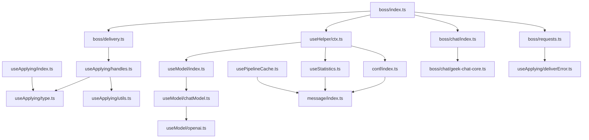

# 03 · 目录结构与模块

## 1. 仓库总体结构

```text
boss-helper/
├─ src/                     # 扩展源码
├─ public/                  # 静态资源：图标、_locales 语言包
├─ docs/                    # 原有截图 img/ + 本套新增分析文档
├─ scripts/
│  ├─ submit.sh             # 通过 wxt submit 发布到商店
│  └─ wxt-run.mjs           # Node 下的 WXT prepare/build/zip 包装器
├─ .github/workflows/
│  └─ main.yml              # Node.js 构建 + GitHub Release
├─ .husky/pre-commit        # npx lint-staged --no-stash
├─ .npmrc                   # legacy-peer-deps 配置
├─ wxt.config.ts            # WXT / Vite / manifest 配置
├─ components.json          # shadcn-vue CLI 配置（风格、别名、tailwind css 目标）
├─ package.json             # 脚本与依赖
├─ package-lock.json        # npm 锁文件
├─ tsconfig.json            # 继承 .wxt/tsconfig.json，定义路径别名
├─ oxlint.config.ts         # oxlint 规则
├─ oxfmt.config.ts          # oxfmt 格式化规则
├─ net-conf.json            # 远程公告/版本信息的同源副本
├─ auto-imports.d.ts        # 自动导入类型声明（WXT / Vue / 本地 composables）
├─ components.d.ts          # 自动组件类型声明
├─ CONTRIBUTING.md          # 贡献指南（原有）
├─ PRIVACY.md               # 隐私说明（原有）
└─ README.md                # 用户向说明（原有）
```

### 1.1 `src/` 目录树

```text
src/
├─ index.ts                       # run(ctx)：注册自定义元素、挂载 Vue
├─ App.vue                        # 右侧吸附图标 + shadcn-vue Sheet 抽屉
├─ env.d.ts                       # window._PAGE / Cookie / __APP_VERSION__ 声明
├─ assets/
│  ├─ main.css                    # Tailwind + shadcn tokens + 卡片/帮助框样式
│  ├─ chat.proto                  # Boss 聊天 protobuf 定义（参考副本）
│  └─ icons/
│     └─ models/                  # 26 个模型图标 *.svg（deepseek/anthropic/zhipu…，由 useModel/icons.ts 映射）
├─ lib/
│  └─ utils.ts                    # shadcn-vue 的 cn()
├─ types/
│  └─ ui.ts                       # 本地 UI 类型
├─ components/
│  ├─ Alert.vue                   # 可关闭并记住关闭状态的公告
│  ├─ Hint.vue                    # 统一 Tooltip 气泡（替代原生 title）
│  ├─ JobDetailDialog.vue         # 岗位详情弹窗（岗位列表与 AI 测试共用）
│  ├─ JobTable.vue                # 岗位列表：虚拟滚动 + 配置过滤 + 下拉加载
│  ├─ StoreIcons.tsx              # 商店图标（JSX）
│  ├─ ui/                         # shadcn-vue CLI 生成的官方组件
│  ├─ AI/
│  │  ├─ LLMForm.vue              # 根据 LLMInfo 动态渲染表单
│  │  ├─ LLMFormItem.vue          # 单个字段渲染
│  │  ├─ LLMModelEdit.vue         # 新建/编辑模型 + 模型测试
│  │  ├─ LLMModelManage.vue       # 模型列表、导入导出
│  │  └─ LLMPromptEdit.vue        # Prompt 编辑 + 用真实岗位测试
│  ├─ Menu/
│  │  └─ Version.vue              # 版本信息与商店入口
│  └─ Tabs/
│     ├─ About.vue                # 关于、鸣谢、反馈
│     ├─ AI.vue                   # AI 开关、模型配置、Prompt 入口
│     ├─ Config.vue               # 运行设置 + 手风琴分组 + 保存/重载/预设/导入导出
│     ├─ Logs.vue                 # 运行日志（投递 / AI 调用 / 系统消息）
│     ├─ Resume.vue               # 简历抓取、候选人摘要、AI 推荐
│     ├─ Search.vue               # 面板岗位搜索（调用 Boss 搜索接口）
│     ├─ Statistics.vue           # 筛选页：统计卡、搜索、岗位列表
│     └─ ConfigItem/
│        ├─ ConfigItem.vue        # ConfigItem 联合类型的分发渲染
│        ├─ Address.vue           # 高德 Key、起点、距离/时间（当前不在配置页展示）
│        ├─ CustomGreeting.vue    # 自定义招呼语（文本/图片）
│        ├─ SalaryRange.vue       # 薪资范围 + 高级单位
│        └─ Form/
│           ├─ FormItem.vue       # 启用复选框 + 包含/排除单选组
│           ├─ FormRange.vue      # [min,max,strict] 三元组输入
│           └─ FormSelect.vue     # 可创建选项的标签输入
├─ composables/
│  ├─ conf/
│  │  ├─ index.ts                 # formData、迁移、保存、预设
│  │  └─ info.ts                  # 默认配置 + 所有配置项的 label/help
│  ├─ useApplying/
│  │  ├─ index.ts                 # 管线引擎、缓存入口、executeAll
│  │  ├─ type.ts                  # Task、TaskResult、WorkflowData、defineTask*
│  │  ├─ handles.ts               # TaskRegistry：所有筛选/招呼任务
│  │  ├─ utils.ts                 # 范围匹配、AI 结果解析、集合读写
│  │  └─ deliverError.ts          # 投递/打招呼/限流错误类型
│  ├─ useHelper/
│  │  ├─ ctx.ts                   # HelperContext 抽象基类
│  │  ├─ index.ts                 # HelperKey、useHelper、版本常量
│  │  ├─ netConf.ts               # 远程公告/版本/反馈配置
│  │  └─ type.ts                  # JobData、Log、ConfigItem 等
│  ├─ useModel/
│  │  ├─ index.ts                 # 模型存储、ModelConf
│  │  ├─ icons.ts                 # provider → 模型图标（assets/icons/models/*.svg）映射
│  │  ├─ openai.ts                # OpenAI 兼容 Provider 定义与表单元数据
│  │  ├─ chatModel.ts             # ChatModel、VueChatState、流式对话
│  │  ├─ common.ts                # 超时等通用字段
│  │  └─ type.ts                  # LLMInfo 类型魔法
│  ├─ usePipelineCache.ts         # 管道结果缓存 + TTL + LRU（投递前命中即跳过）
│  ├─ useRiskControl/             # 风控策略模块：types / policies / 注册表，流程只消费 RiskDecision
│  ├─ useBossJobSearch.ts         # Boss 岗位搜索/详情接口 + 面板搜索结果
│  ├─ useBossStoken.ts            # 37 时在后台标签页重签 __zp_stoken__（调用 background）
│  ├─ usePanelSearch.ts           # 面板搜索统一入口：节流判定、结果提示、抽屉首开自动搜一发
│  ├─ useBossSearch.ts            # 搜索选项（城市/经验/学历/薪资）与条件
│  ├─ useJobMatching.ts           # 配置条件 → 岗位匹配（面板列表过滤）
│  ├─ useJobListFilter.ts         # 岗位列表「按配置过滤」开关（JobTable 与数据面板共用）
│  ├─ useLogs.ts                  # 运行日志：投递 / AI 调用 / 系统消息
│  ├─ useBossResume.ts            # 简历接口抓取 + iframe 抓取 + 摘要
│  ├─ usePanelTab.ts              # 抽屉当前页 tab（模块级 ref，供跨页跳转）
│  ├─ useScrollLock.ts            # 抽屉打开时锁住宿主页面滚动（防 scroll chaining）
│  ├─ useToast.ts                 # 封装 vue-sonner 的 useToast（自动导入来源）
│  └─ useStatistics.ts            # 今日/历史统计
├─ entrypoints/
│  ├─ background.ts               # 后台入口，注册 BackgroundCounter
│  ├─ content.ts                  # 内容脚本入口，注入 boss.js；带 #__bh_resign 时只做重签
│  ├─ boss/
│  │  ├─ index.ts                 # boss.js 入口 + BossHelperCtx 实现
│  │  ├─ autoReply.ts             # AI 自动回复：订阅 MQTT 消息 → 生成 → 发送
│  │  ├─ delivery.ts              # bossWorkflow 任务编排
│  │  ├─ requests.ts              # 投递/详情/Boss 信息/图片上传接口
│  │  ├─ types.ts                 # Boss 接口返回类型
│  │  └─ chat/
│  │     ├─ index.ts              # MQTT 连接与 protobuf 初始化
│  │     └─ geek-chat-core.ts     # protobuf 消息构造器
│  └─ options/index.html          # options 占位页（无脚本）
├─ message/
│  ├─ index.ts                    # initCounter、counter Proxy、ExtStorage
│  ├─ background.ts               # BackgroundCounter + 两个 Adapter
│  ├─ contentScript.ts            # ContentCounter + storage 键前缀规则
│  └─ contentScriptShare.ts       # 主世界 ↔ 内容脚本的 CustomEvent Adapter
├─ types/
│  ├─ formData.ts                 # FormData、Statistics、Prompt 等
│  └─ pipelineCache.ts            # 缓存项/配置类型
└─ utils/
   ├─ ai.ts                       # renderTemplate、部分 JSON 解析
   ├─ amap.ts                     # 地理编码、三种距离
   ├─ deepmerge.ts                # deepmerge / jsonClone
   ├─ file.ts                     # 文件 MD5
   ├─ index.ts                    # delay、loader、notification、getUuid 等
   ├─ jsonImportExport.ts         # 配置导入导出
   ├─ logger.ts                   # 本地日志封装，写入 useLogs 的日志页存储
   └─ request.ts                 # 通用 fetch 封装（background 可选）
```

## 2. 入口与构建产物对应关系

WXT 会扫描 `src/entrypoints/`：

| 源文件                           | 构建产物                     | 运行环境   | 说明                             |
| -------------------------------- | ---------------------------- | ---------- | -------------------------------- |
| `entrypoints/background.ts`      | background service worker    | 扩展后台   | 注册 `BackgroundCounter` 代理    |
| `entrypoints/content.ts`         | content script               | 隔离世界   | `document_start`，注入 `boss.js` |
| `entrypoints/boss/index.ts`      | `boss.js`（unlisted script） | 页面主世界 | `web_accessible_resources`       |
| `entrypoints/options/index.html` | options 页面                 | 扩展页面   | 占位，无实际功能                 |
| `src/index.ts`                   | 被 `boss.js` 引用            | 主世界     | 不是独立入口                     |

`boss.js` 需要在 manifest 中声明为可访问资源，配置在 `wxt.config.ts`：

```ts
web_accessible_resources: [
  { resources: ['boss.js'], matches: ['*://zhipin.com/*', '*://*.zhipin.com/*'] },
]
```

## 3. 模块职责详解

### 3.1 `src/index.ts`：挂载器

- `run(ctx)`：注册 `boss-helper-job` 自定义元素，并把它 append 到 `document.body`
  - 扩展重载 / 脚本重复注入时，`customElements` 注册表里已有同名标签，重复 `define` 会抛 `NotSupportedError: name "boss-helper-job" has already been used`；所以这里先摘掉旧宿主，再按 `boss-helper-job`、`boss-helper-job-2`… 递增取一个空闲标签注册，由新实例接管 UI
  - 宿主元素带 `data-boss-helper-host` 属性，`ctx.onMount()` 靠它复用宿主，不会重复创建
- `_connectedCallback`：创建 Shadow DOM、注入内联 CSS、`createApp`、`provide(HelperKey, ctx)`、`mount`
- `disconnectedCallback`：`app.unmount()`，防止路由切换后的内存泄漏
- 最后调用 `ctx.onMount()`

### 3.2 `src/App.vue`：主面板

- 左侧菜单：简历、筛选、配置、AI、日志、关于（`panels` 映射到组件，菜单与内容区共用）
- 版本按钮：`helper.netConf.version > VITE_VERSION` 时显示更新圆点（字符串比较）
- 订阅 `netConf.notification`，渲染远程公告
- 帮助模式：`useRafFn` + `elementFromPoint` + `[data-help]` + Tooltip
- 挂载时执行 `conf.confInit()`、`model.initModel()`
- 抽屉里渲染当前菜单对应的面板；不再有独立对话面板
- 关闭方式：X / Esc / 双击蒙层（`onDrawerInteractOutside` 无条件 `preventDefault`，`onRootDblClick` 只认蒙层）

### 3.3 `src/entrypoints/boss/index.ts`：站点适配核心

| 成员                              | 作用                                                            |
| --------------------------------- | --------------------------------------------------------------- |
| `convertBossZpJobItemToJobData()` | 从 `useBossJobSearch.ts` 导出，把搜索结果的原始项转成 `JobData` |
| `BossHelperCtx`                   | 实现 `HelperContext`                                            |
| `BossHelperCtx.new()`             | 构建 workflow                                                   |
| `onMount()`                       | 创建 UI 宿主、连接聊天、启动 `AutoReplyService`                 |
| `loadMoreActiveJobs()`            | 拉搜索接口下一页并追加；`searchMeta.hasMore` 为假就不再翻       |
| `onPanelOpen()`                   | 抽屉首次打开时按上次条件自动搜一发（`autoSearchOnPanelOpen`）   |
| `start()`                         | 执行 `workflow.executeAll(_jobDataMap)`                         |
| `sendMessage()`                   | 构造 protobuf 消息，通过 MQTT 发送文本/图片                     |
| `getConfigItems()`                | 生成配置页 UI 描述：全部常显、按类别分组（「地址配置」不展示）  |

### 3.4 `src/entrypoints/boss/chat/` 与 `autoReply.ts`

- `chat/index.ts`：`GeekChatClientManager.connect()`
  - `GET https://www.zhipin.com/wapi/zppassport/get/wt` 取 `wt2`
  - 取 `window._PAGE.token`
  - `mqtt.connect('wss://ws6.zhipin.com/chatws', ...)`
  - 用 `ProtoBufferMessage` 构造消息
- `chat/geek-chat-core.ts`：把内嵌的 `.proto` 字符串解析成 protobuf Root，提供 `createTextMessage`、`createImageMessage`、`createStickerMessage`、`createReadMessage` 等
- `autoReply.ts`：`AutoReplyService`
  - 订阅 `chat` 主题并 `decode` 收到的消息，只处理文字消息
  - 用 `securityId`（优先）或招聘者 uid 找到 `jobMaps` 里的岗位
  - 自己发的消息只记入上下文，不触发回复
  - 每个岗位保留最近 12 条对话、至少间隔 8 秒、最多自动回 10 条
  - 调 `chatModel.chat('reply', job, { extra: { reply, messages } })` 生成回复并 `sendMessage`

### 3.5 `src/message/`

| 文件                    | 关键导出                                                                   | 作用                                                     |
| ----------------------- | -------------------------------------------------------------------------- | -------------------------------------------------------- |
| `index.ts`              | `initCounter`、`counter`、`ExtStorage`                                     | 主世界初始化代理；把 `counter.foo()` 转发到内容脚本      |
| `background.ts`         | `BackgroundCounter`、`ProvideBackgroundAdapter`、`InjectBackgroundAdapter` | 跨域请求、通知、图片 IndexedDB、fetch、重签标签页        |
| `contentScript.ts`      | `ContentCounter`                                                           | 实现存储读写、转发后台能力；`genKey` 补全存储前缀        |
| `contentResign.ts`      | `readResignTask`、`runResign`                                              | 重签标签页里的两段式流程：过期旧令牌 → reload → 等新令牌 |
| `contentScriptShare.ts` | `ProvideContentAdapter`、`ProvideContentScriptAdapter`                     | 主世界与内容脚本的事件桥                                 |

### 3.6 `src/composables/conf/`

- `info.ts`：`formInfoData`（label/help）+ `defaultFormData`（全部默认值）
- `index.ts`：
  - `formData`：模块级 `reactive`，改动后由页面组件防抖调用 `confSaving(true)` 自动保存
  - `FROM_VERSION`：配置迁移
  - `confInit`、`confSaving(silent?)`、`confReload`、`confExport`、`confImport`、`confDelete`、`confRecommend`
  - 预设：`createPreset`、`switchPreset`

### 3.7 `src/composables/useApplying/`

这是项目的核心业务引擎，详见 [04-投递工作流.md](./04-投递工作流.md)。

### 3.8 `src/composables/useModel/`

AI 抽象层，详见 [06-AI能力.md](./06-AI能力.md)。

### 3.9 `src/utils/`

| 文件                  | 说明                                                                                                                       |
| --------------------- | -------------------------------------------------------------------------------------------------------------------------- |
| `ai.ts`               | `renderTemplate` 渲染 `{{ jobData.x }}`；`parseGptJson` 用 `partial-json` 容错解析                                         |
| `amap.ts`             | 高德地理编码 `/v3/geocode/geo`；`/v3/distance` 三种 type                                                                   |
| `deepmerge.ts`        | 配置合并；`jsonClone` 用于去除 Vue Proxy                                                                                   |
| `file.ts`             | `SparkMD5` 计算文件 MD5，用于图片秒传                                                                                      |
| `index.ts`            | `delay`、`loader` 顶部进度条、系统通知、`getCurDay/getCurTime`、`getUuid`、`errorHandle`                                   |
| `jsonImportExport.ts` | 浏览器下载/上传 JSON                                                                                                       |
| `logger.ts`           | 本地日志封装：`debug/info/warn/error` 写入日志页存储，不写 console；级别读 localStorage `__BH_LOG_LEVEL__`（默认 `debug`） |
| `request.ts`          | 通用 `fetch` 封装，支持走 background 代理；业务代码大多直接用 `fetch`                                                      |

## 4. 别名与自动导入

`tsconfig.json` 定义的路径别名：

| 别名          | 指向            |
| ------------- | --------------- |
| `@` / `@/*`   | `src` / `src/*` |
| `~` / `~/*`   | `src` / `src/*` |
| `@@` / `@@/*` | 仓库根          |
| `~~` / `~~/*` | 仓库根          |

WXT、`unplugin-auto-import` 与 `unplugin-vue-components` 会让部分代码“看起来少了 import”，例如：

- `defineContentScript`、`defineBackground`、`defineUnlistedScript`、`injectScript` 来自 `#imports`
- `browser`、`storage`、`notification` 来自 WXT
- `useToast` 来自本地 `src/composables/useToast.ts`
- `Button`、`Dialog`、`Table` 等来自 `src/components/ui/`
- 部分 `ref/computed/watch`、`delay/logger/jsonClone` 等来自自动导入配置

阅读代码时，如果遇到未声明标识符，先查 `auto-imports.d.ts`、`components.d.ts` 和 `wxt.config.ts`。

## 5. 代码约定

从 `oxfmt.config.ts` / `oxlint.config.ts` 与现有代码可以归纳出：

- 不写分号，单引号，导入排序按分区注释
- 类型导入使用 `import type`
- 组件名 PascalCase，组合式函数 `useXxx`
- 任务 id 使用中文短语（如 `'岗位详情获取'`、`'AI 过滤'`），既作为标识也作为 UI 文案和日志标签
- 运行日志用 `useLogs` 的 `addJobLog` / `addAiLog` / `addSystemLog`；调试日志同样进面板日志页——`logger`（含 `logger.withContext({...})` 派生的 `log.info/warn/error`）全部写入 `useLogs` 的存储、不写 console，`warn` 记成橙色 skip
- 错误类型统一继承 `BossHelperError`，便于 UI 区分状态
- 配置读取直接 `ctx.helper.conf.formData.xxx`，没有 getter 层

## 6. 遗留代码与未完成部分

| 位置                                 | 现状                                                            | 影响                                                                   |
| ------------------------------------ | --------------------------------------------------------------- | ---------------------------------------------------------------------- |
| `entrypoints/options/index.html`     | 只有 HTML 骨架，没有脚本，`<title>Options Title</title>`        | options 页面为空                                                       |
| `assets/chat.proto`                  | 未被构建引用；`geek-chat-core.ts` 内嵌了一份等价的 proto 字符串 | 仅作协议参考                                                           |
| `request.ts`                         | 通用封装存在，但 Boss 接口和 AI 请求大多直接用 `fetch`          | 两套请求风格并存                                                       |
| `sameCompanyFilter` / `sameHrFilter` | 任务名与键的选择不一致                                          | 见 [11-已知限制与风险.md](./11-已知限制与风险.md#3-代码层面的已知问题) |

## 7. 模块依赖速查



下一篇：[04-投递工作流.md](./04-投递工作流.md)。
