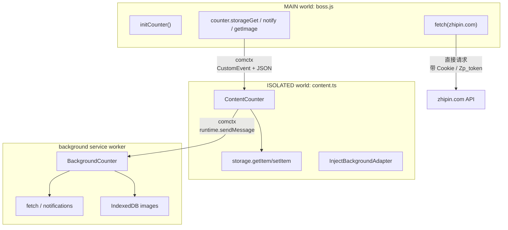
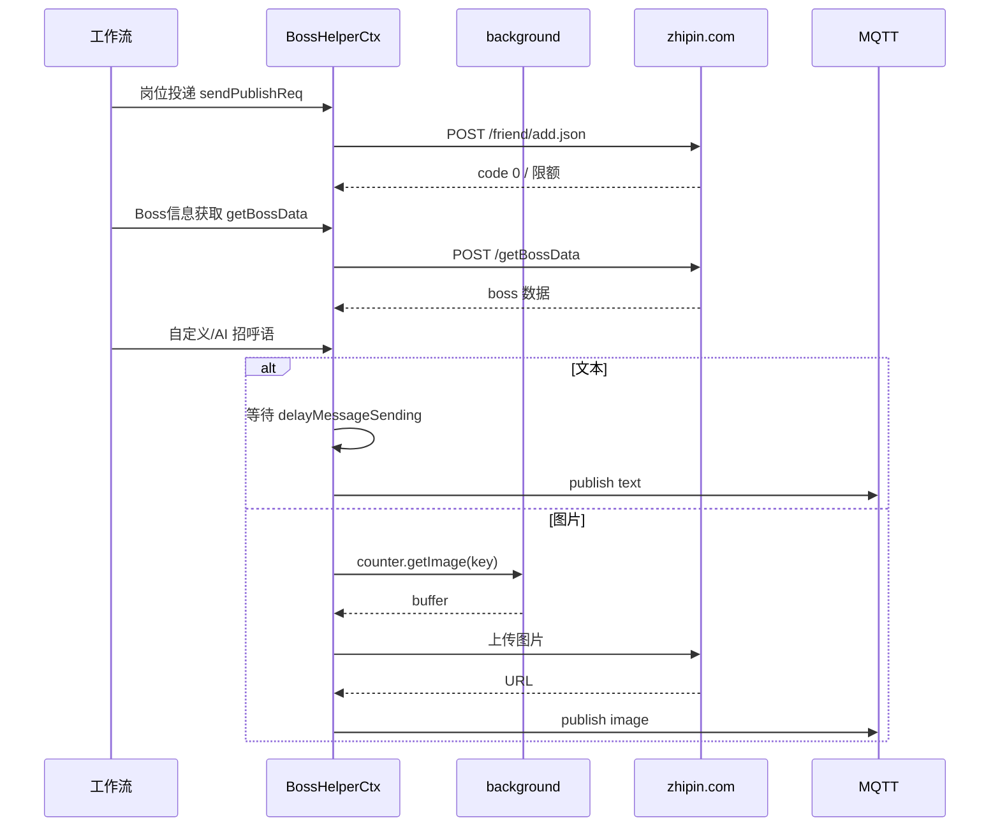

# 07 · 消息与通信

BossHelper 的通信可以分成五层：

1. **扩展内部三层 RPC**：主世界 ↔ content script ↔ background
2. **存储代理**：主世界通过 content script 读写 `browser.storage`
3. **页面 Vue 桥接**：读取/劫持 Boss 页面自己的 Vue 数据
4. **HTTP 接口**：投递、详情、Boss 信息、图片上传、高德、版本公告
5. **WebSocket / MQTT**：发送聊天消息

## 1. 三层 RPC 总览



### 1.1 为什么需要三层

- 主世界脚本**没有** `browser.*` 权限，但只有它能读取页面 `window._PAGE`、`window.Cookie`、`#wrap.__vue__`
- content script **有**扩展 API，但运行在隔离世界，读不到页面 JS 变量
- background 适合做跨域请求、系统通知、IndexedDB 等与页面生命周期无关的事

### 1.2 comctx 代理

三处 `defineProxy`：

**background**（`src/entrypoints/background.ts`）：

```ts
const [provideBackgroundCounter] = defineProxy(
  () => new BackgroundCounter(),
  { namespace: '__boss-helper-background__' },
)
provideBackgroundCounter(new ProvideBackgroundAdapter())
```

**content**（`src/entrypoints/content.ts`）：

```ts
const [, injectBackgroundCounter] = defineProxy(
  () => ({}) as BackgroundCounter,
  { namespace: '__boss-helper-background__' },
)

const [provideContentCounter] = defineProxy(
  () => new ContentCounter(injectBackgroundCounter(new InjectBackgroundAdapter())),
  { namespace: '__boss-helper-content__', heartbeatTimeout: 3000 },
)
```

**主世界**（`src/message/index.ts`）：

```ts
const [, injectCounter] = defineProxy(
  () => ({}) as ContentCounter,
  { namespace: '__boss-helper-content__' },
)
_counter = injectCounter(new InjectAdapter(script))
```

命名空间把“提供方”和“调用方”配对：

| 命名空间 | 提供方 | 调用方 |
| --- | --- | --- |
| `__boss-helper-background__` | background | content |
| `__boss-helper-content__` | content | 主世界 |

`heartbeatTimeout: 3000` 表示 content 代理 3 秒没有心跳就认为断连。

## 2. 主世界 ↔ content script

### 2.1 注入脚本

`src/entrypoints/content.ts`：

```ts
export default defineContentScript({
  matches: ['*://zhipin.com/*', '*://*.zhipin.com/*'],
  runAt: 'document_start',
  world: 'ISOLATED',
  async main() {
    // ...
    await injectScript('/boss.js', {
      keepInDom: true,
      modifyScript(script) {
        provideContentCounter(new ProvideContentScriptAdapter(script))
      },
    })
  },
})
```

- `document_start`：尽量早于页面应用启动
- `world: 'ISOLATED'`：content script 在隔离世界
- `keepInDom: true`：注入的 `<script>` 保留在 DOM 中，作为通信锚点
- `boss.js` 是 WXT 的 unlisted script，构建后在 `web_accessible_resources` 中声明

### 2.2 通信适配器

`ProvideContentScriptAdapter`（`src/message/contentScriptShare.ts`）：

```ts
export class ProvideContentScriptAdapter implements Adapter {
  constructor(public script: HTMLScriptElement) {}

  sendMessage = (message) => {
    this.script.dispatchEvent(
      new CustomEvent('_boss-helper-message_', { detail: JSON.stringify(message) }),
    )
  }

  onMessage = (callback) => {
    const handler = (event) => callback(JSON.parse(event.detail))
    this.script.addEventListener('_boss-helper-message_', handler)
    return () => this.script.removeEventListener('_boss-helper-message_', handler)
  }
}
```

特点：

- 事件挂在 `<script>` 元素上，而不是 `document`，减少与页面其它脚本的冲突
- 消息用 `JSON.stringify` 序列化，避免跨世界对象不能直接传递的问题
- 同一份代码在主世界和 content 两侧复用

`contentScriptShare.ts` 还保留了 `ProvideContentAdapter`（挂 `document`，Firefox 下用 `cloneInto`），但当前未被使用，属于备选方案。

### 2.3 `counter` 代理

`src/message/index.ts`：

```ts
export const counter = new Proxy({} as ContentCounter, {
  get(_, key) {
    if (!_counter) throw new Error('Counter has not been initialized...')
    const value = _counter[key]
    return typeof value === 'function' ? value.bind(_counter) : value
  },
  set(_, key, value) { ... },
})
```

调用 `counter.storageGet(...)` 时，实际是通过 comctx 代理到 content 的 `ContentCounter.storageGet`。

`initCounter()` 必须在任何 `counter.*` 调用之前执行。`boss.js` 入口第一行就是 `initCounter()`。

## 3. content script 与 background

### 3.1 `BackgroundCounter`

| 方法 | 作用 |
| --- | --- |
| `request({url,data,timeout,responseType})` | 带 `credentials: 'include'` 的跨域 fetch，返回 JSON/text |
| `notify(args)` | `browser.notifications.create` |
| `fetch(...args)` | 原样转发 fetch |
| `getImage(key)` | 从 IndexedDB 读 `File`，返回 `{name,type,buffer:number[]}` |
| `setImage({name,type,buffer})` | 存入 IndexedDB，key 为 `img-<md5>` |
| `backgroundTest(type)` | 代理连通性测试（未使用） |

`request` 的细节：

```ts
const signal = AbortSignal.timeout(args.timeout * 1000)
const res = await fetch(args.url, {
  ...args.data,
  signal,
  mode: 'cors',
  credentials: 'include',
})
```

- `timeout` 单位是秒
- 带 Cookie，适合需要登录态的请求
- 非 2xx 会抛错并带上响应文本

### 3.2 图片存储

- 数据库：`ExtensionGlobalDB`
- 对象仓库：`images`
- key：`img-${md5}`
- value：`File`
- `getImage` 返回 `number[]`（`Array.from(new Uint8Array(arrayBuffer))`），因为跨上下文不能直接传 `File`

这套机制用于“自定义招呼语中的图片”：

1. 用户在设置中选图
2. `CustomGreeting.vue` 调 `counter.setImage` 存入 IDB
3. `formData.customGreeting.value` 只保存 key
4. 发送时 `counter.getImage(key)` 取回字节 → 构造 `File` → 上传到 Boss

### 3.3 消息路由

`ProvideBackgroundAdapter.sendMessage`：

```ts
switch (message.meta.injector) {
  case 'content': {
    const tabs = await browser.tabs.query({ url: message.meta.url })
    void tabs.map(tab => browser.tabs.sendMessage(tab.id!, message))
    break
  }
  case 'popup': {
    await browser.runtime.sendMessage(message)
    break
  }
}
```

`InjectBackgroundAdapter` 发送时带上：

```ts
meta: { url: document.location.href, injector: this.name }
```

`this.name` 在 content 中是 `'content'`。background 收到后会用 `message.sender.name` 覆盖 `meta.injector`。

> 当前没有 popup 页面；`popup` 分支是预留能力。

### 3.4 存储键前缀

`ContentCounter.genKey`：

```ts
function genKey(key: string): StorageItemKey {
  const prefixes = ['local:', 'session:', 'sync:', 'managed:']
  return prefixes.some(p => key.startsWith(p)) ? key as StorageItemKey : `sync:${key}`
}
```

这意味着：

- `counter.storageSet('conf-model', data)` → `sync:conf-model`
- `counter.storageSet('local:sameCompany', data)` → `local:sameCompany`

`ExtStorage`（供 `useStorageAsync`）也走这套规则，所以 `appearance-conf` 实际是 `sync:appearance-conf`。

### 3.5 `ExtStorage` 的轮询

```ts
export const ExtStorage: StorageLikeAsync = {
  async getItem(key) {
    return new Promise((resolve) => {
      const t = setInterval(() => {
        if (_counter) {
          void counter.storageGet(key).then(v => resolve(v as never))
          clearInterval(t)
        }
      }, 200)
    })
  },
  ...
}
```

因为 `useStorageAsync` 可能在 `initCounter()` 之前初始化，这里用 200ms 轮询等待 `_counter`。若 `initCounter()` 永远不执行，这个 Promise 永远不会 resolve。

## 4. 页面 Vue 实例桥接

### 4.1 取得根实例

```ts
const rootVue = ref()

export async function getRootVue(): Promise<any> {
  const waitVueMount = async () => new Promise((resolve, reject) => {
    const interval = setInterval(() => {
      const wrap = document.querySelector('#wrap')
      if (rootVue.value !== undefined) return resolve(rootVue.value)
      if (wrap && '__vue__' in wrap) {
        rootVue.value = wrap.__vue__
        resolve(rootVue.value)
        clearInterval(interval)
      }
    }, 300)
    setTimeout(() => {
      reject(new Error('未找到vue根组件'))
      clearInterval(interval)
    }, 20000)
  })
  await waitVueMount()
  return rootVue.value
}
```

- 轮询间隔 300ms，超时 20 秒
- 依赖页面把 Vue 根实例挂在 `#wrap.__vue__`
- 拿到后缓存到模块级 `rootVue`

### 4.2 劫持数据属性

```ts
export function useHookVueData(selectors, key, data, update?) {
  return async () => {
    const jobVue = await new Promise((resolve, reject) => {
      const interval = setInterval(() => {
        const jobVue = document.querySelector(selectors)?.__vue__
        if (jobVue) { resolve(jobVue); clearInterval(interval) }
      }, 100)
      setTimeout(() => { reject(new Error('未找到对应元素')); clearInterval(interval) }, 20000)
    })

    data.value = jobVue[key]
    update?.(jobVue[key])

    const originalSet = jobVue.__lookupSetter__(key)
    Object.defineProperty(jobVue, key, {
      set(val) {
        data.value = val
        update?.(val)
        originalSet.call(this, val)
      },
    })
  }
}
```

- 先同步一次当前值
- 再用 `Object.defineProperty` 覆盖 setter，保留原 setter 并转发
- 页面每次更新 `jobList` / `pageVo` / `hasMore` / `jobDetail`，扩展都会收到

使用位置（`boss/index.ts`）：

| 选择器 | key | 目标 |
| --- | --- | --- |
| `#wrap .page-job-wrapper` 等 | `pageChangeAction` | 翻页方法 |
| `#wrap .page-job-wrapper` 等 | `searchJobAction` / `onSearch` | 搜索方法 |
| `#wrap .page-job-wrapper` 等 | `jobList` | 职位列表 |
| `#wrap .page-job-wrapper` 等 | `pageVo` | 分页信息 |
| `#wrap .page-job-wrapper` 等 | `hasMore` | 是否还有下一页 |
| `#wrap .page-job-wrapper` 等 | `jobDetail` | 当前职位详情 |
| `#wrap .page-job-wrapper` 等 | `clickJobCardAction` | 点击职位卡片的方法 |

### 4.3 取方法

```ts
export function useHookVueFn(selectors, key: string | string[]) {
  return async () => {
    const jobVue = await waitForVue(selectors)
    if (Array.isArray(key)) {
      for (const k of key) if (jobVue[k]) return jobVue[k]
    }
    return jobVue[key]
  }
}
```

`initSearch` 就是传入数组 `['searchJobAction', 'onSearch']`，哪个存在用哪个，以适配不同页面版本。

### 4.4 局限

- 强依赖 Vue 2 的 `__vue__` 暴露方式
- 选择器是硬编码的，Boss 改版会失效
- 每个 `useHookVueData` 都要等 20 秒超时
- 劫持 setter 可能影响页面自身行为（虽然保留了原 setter）
- 同一属性被重复劫持时，`__lookupSetter__` 可能拿到上一次的包装函数，导致链式调用

## 5. Boss HTTP 接口

所有请求都从**页面主世界**发出，使用 `window.Cookie.get('bst')` 作为 `Zp_token`。

### 5.1 投递

```http
POST https://www.zhipin.com/wapi/zpgeek/friend/add.json?securityId=...&jobId=<encryptJobId>
Zp_token: <bst>
```

`sendPublishReq` 的处理逻辑：

```ts
const res = await fetch(url, { method: 'POST', headers: { Zp_token: token } }).then(r => r.json())

if (res.code === 0) return res

if (res.code === 1) {
  const content = res.zpData?.bizData?.chatRemindDialog?.content || res.message

  if (content.includes('您今天已与120位BOSS沟通')) {
    // 命中 120 次弹窗：先确认 chatremind，再带 cid=1 重试
    await fetch(`/wapi/zpCommon/actionLog/geek/chatremind.json?ba=...&action=addf-limit-popup-c`, {
      method: 'POST', headers: { Zp_token: token },
    })
    return sendPublishReq(data, undefined, retries, { cid: 1 })
  }

  if (content.includes('您今天已与150位BOSS沟通')) throw new LimitError(content)
  if (content.includes('操作过于频繁')) throw new RateLimitError(content)
  throw new PublishError(content)
}
```

- 120 次是“软限制”，会弹确认框；脚本模拟确认后继续
- 150 次是“硬限制”，抛 `LimitError`
- 操作频繁抛 `RateLimitError`
- 其它业务错误抛 `PublishError`
- 网络异常会递归重试，默认 3 次
- 若返回 `code !== 0` 且不是上述情况，抛 `PublishError('未知错误状态:...')`

`deliveryLimit` 默认 120，UI 最大 155，但 Boss 自身上限是 150；超过 150 后必然失败。

### 5.2 职位详情

```http
GET https://www.zhipin.com/wapi/zpgeek/job/detail.json?securityId=...&lid=...&_=<timestamp>
Zp_token: <bst>
```

- 超时 5 秒
- 当前**没有被使用**：扩展改为“点击职位卡片，等待页面 `jobDetail` 更新”
- 保留该函数可能是为了以后绕过页面点击

### 5.3 Boss 信息

```http
POST https://www.zhipin.com/wapi/zpchat/geek/getBossData
Content-Type: multipart/form-data
Zp_token: <bst>

bossId=<encryptUserId>
securityId=<securityId>
bossSrc=0
```

- 返回 `BossZpBossData`
- 非好友关系会重试，默认 3 次
- 调用点在 `delivery.ts`：

  ```ts
  const bossData = await getBossData({
    securityId: rawData.jobitem.securityId,
    encryptUserId: ctx.helper.uid,
  })
  ```

  这里传入的是**当前登录用户**的 `encryptUserId`（`window._PAGE.encryptUserId`），而 `getBossData` 的参数名是 `encryptUserId`，语义上更像“Boss 的加密 id”。这是一个代码疑点：如果接口确实期望 Boss 的 id，招呼语发送可能拿不到正确的 Boss 数据。使用中若出现“Boss信息获取失败/发送对象错误”，应优先检查这里。详见 [11-已知限制与风险.md](./11-已知限制与风险.md#3-代码层面的已知问题)。

### 5.4 图片上传

两步：

1. **秒传检查**

```http
POST https://www.zhipin.com/wapi/zpupload/quicklyUpload
zp_token: <bst>
Content-Type: application/x-www-form-urlencoded

fileMd5=<md5>&fileSize=<size>&source=chat_file&securityId=<securityId>
```

命中（`code === 0` 且有 `zpData.url`）则直接返回图片 URL，不传文件。

2. **普通上传**

```http
POST https://www.zhipin.com/wapi/zpupload/image/uploadSingle
zp_token: <bst>
Content-Type: multipart/form-data

securityId=...
source=chat_file
file=@image
```

返回的 `tinyUrl` / `url` / `width` / `height` 用于构造 protobuf 图片消息。

### 5.5 其它接口

| 接口 | 用途 |
| --- | --- |
| `GET https://www.zhipin.com/wapi/zppassport/get/wt` | 取聊天 WebSocket 的 `wt2` |
| `GET https://restapi.amap.com/v3/geocode/geo` | 地址 → 经纬度 |
| `GET https://restapi.amap.com/v3/distance` | 直线/驾车/步行距离与时间 |
| `GET https://testingcf.jsdelivr.net/gh/Ocyss/boss-helper@main/net-conf.json` | 远程版本、公告、商店链接、反馈地址 |

`net-conf.json` 的结构：

```ts
interface NetConf {
  version: string
  version_description?: string
  notification: Array<
    | { key: string; type: 'alert'; data: AlertProps }
    | { key: string; type: 'notification'; data: Toast & { url?: string; duration?: number } }
  >
  store?: Record<string, [string, string, string]>
  price_info?: { signedKey: number; account: number; update_time: string }
  feedback: string
}
```

- 每 5 分钟刷新一次（`HelperContext.initNetConf` 里的 `setInterval`）
- `notification` 会按 key 去重，并用 `local:netConf-<key>` 记录已读时间
- `version` 用于顶部“有更新”圆点

## 6. MQTT 聊天

### 6.1 连接流程

```ts
async connect() {
  const res = await fetch('https://www.zhipin.com/wapi/zppassport/get/wt').then(r => r.json())
  const wt = res.zpData.wt2
  const token = window._PAGE?.token

  this.client = mqtt.connect('wss://ws6.zhipin.com/chatws', {
    clientId: `ws-${getUuid(16, 16)}`,
    username: `${token}|0`,
    password: wt,
    keepalive: 25,
    clean: true,
    reconnectPeriod: 1000,
    connectTimeout: 10000,
    protocolVersion: 4,
    createWebsocket: (url) => new WebSocket(url, wt ? [wt] : ['mqtt']),
  })

  this.msgBuilder = new ProtoBufferMessage({
    userId: Number(window._PAGE?.uid ?? window._PAGE?.userId),
    token,
    platform: 'web',
    friendSource: 0,
    supportPush: true,
    wt,
  })
}
```

- `wt` 既作为 MQTT 密码，也作为 WebSocket 子协议
- `username` 是 `<token>|0`
- `clean: true` 表示不保留会话
- `keepalive: 25` 秒
- 连接失败会按 `reconnectPeriod` 自动重连（MQTT 客户端行为）

### 6.2 protobuf 消息构造

`geek-chat-core.ts` 把一段内嵌的 `.proto` 字符串解析成 `protobufjs.Root`，再 lookup `TechwolfChatProtocol`。

主要方法：

| 方法 | 消息类型 | 用途 |
| --- | --- | --- |
| `createTextMessage(stanza, { text })` | type 1 | 文本 |
| `createImageMessage(stanza, { content })` | type 3 | 图片 |
| `createStickerMessage` | type 20 | 动画表情 |
| `createActionMessage` | type 4 | 动作/卡片 |
| `createReadMessage` | type 6 | 已读回执 |
| `createIqMessage` | type 3 | IQ 查询（如 `/message/suggest`） |
| `createPresence` | type 2 | 在线状态 |

`MessageStanza`：

```ts
type MessageStanza = {
  uid: number
  groupId?: number
  encryptUid?: string
  encryptGid?: string
  friendSource?: number
  clientMid: number
}
```

`sendMessage()`（`boss/index.ts`）构造：

```ts
const stanza = {
  uid: Number(data.rawData.boss.data.bossId),
  friendSource: data.rawData.boss.data.bossSource ?? 0,
  encryptUid: data.rawData.jobitem.encryptBossId,
  encryptGid: '',
  clientMid: Date.now(),
}
```

- `uid` 是 Boss 的数值 id
- `encryptUid` 是列表项里的 `encryptBossId`
- `clientMid` 每条消息都重新取 `Date.now()`；源码注释说明复用会导致后续消息被当成重复

### 6.3 发送

```ts
this.geek.client.publish('chat', this.geek.msgBuilder.encode(m), {
  qos: 1,
  retain: true,
})
```

- topic：`chat`
- QoS 1：至少一次
- `retain: true`：保留最后一条消息（Boss 客户端行为要求）

文本发送前：

```ts
this.pendingMessages.value = msg.content
await delay(this.conf.formData.delayMessageSending)
m = this.geek.msgBuilder.createTextMessage(stanza, {
  text: this.pendingMessages.value,
})
this.pendingMessages.value = undefined
```

`pendingMessages` 绑定在 `ChatBox` 的 `UChatPrompt` 上，因此在延迟期间用户可以手动修改内容。

### 6.4 图片发送

```ts
const response = await counter.getImage(msg.image)
const u8Array = new Uint8Array(response.buffer)
const file = new File([u8Array.buffer], response.name, { type: response.type })
const img = await uploadImage(data.rawData.boss.data.securityId, file)

m = this.geek.msgBuilder.createImageMessage(stanza, {
  content: { iid: 0, ...img },
})
```

- `securityId` 来自 Boss 数据
- `img` 包含 `tinyImage` 与 `originImage`
- 图片先经过“秒传”或普通上传，再用返回的 URL 构造 protobuf

### 6.5 只发不收

当前代码只调用了 `client.publish`，**没有 `client.subscribe`，也没有处理下行消息**。因此：

- 扩展能发送招呼语
- 不能读取 Boss 的回复
- “AI 自动回复聊天”没有实现基础
- `ChatBox` 显示的是本地 AI 生成的会话，不是真实聊天记录

### 6.6 发送时序



## 7. 错误类型

`src/composables/useApplying/deliverError.ts`：

| 类型 | `name` | `state` | 场景 |
| --- | --- | --- | --- |
| `BossHelperError` | 基类 | `warning`/`danger` | 统一基类 |
| `UnknownError` | 未知错误 | `danger` | 未分类 |
| `PublishError` | 投递出错 | `danger` | 投递失败 |
| `GreetError` | 打招呼出错 | `danger` | Boss 信息/招呼失败 |
| `LimitError` | 达到限制 | `danger` | 150 次硬限制 |
| `RateLimitError` | 操作频繁 | `danger` | 触发风控 |

这些错误会被 `HelperContext.logs.add` 记录，`state` 决定日志颜色。

## 8. 隐私与安全

- `bst` Cookie 与 `window._PAGE.token` 是登录态凭证，仅用于请求 Boss 接口，未上传到第三方
- AI 请求会携带岗位数据到用户配置的 API
- `net-conf.json` 请求会暴露 IP（项目隐私政策中也提到日活统计）
- 图片保存在 IndexedDB，卸载扩展会删除
- 消息通过 Boss 官方 WebSocket 发送，但仍然属于自动化行为，存在风控风险

下一篇：[08-数据模型.md](./08-数据模型.md)。
