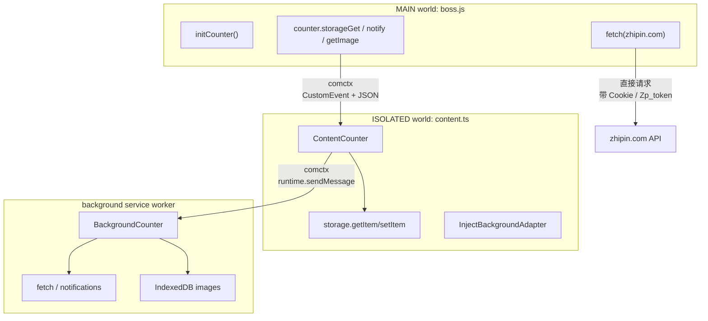
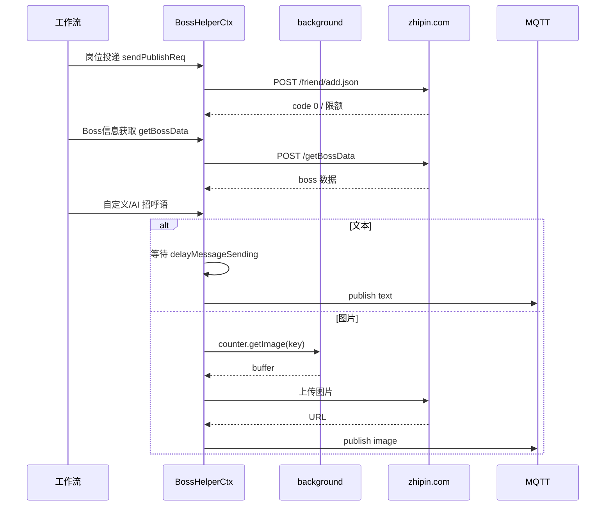

# 07 · 消息与通信

boss-helper-plus 的通信可以分成五层：

1. **扩展内部三层 RPC**：主世界 ↔ content script ↔ background
2. **存储代理**：主世界通过 content script 读写 `browser.storage`
3. **页面读取**：只读 `window._PAGE` / `Cookie` 取登录信息，不再桥接页面 Vue
4. **HTTP 接口**：投递、详情、Boss 信息、图片上传、高德、版本公告
5. **WebSocket / MQTT**：发送聊天消息

## 1. 三层 RPC 总览



### 1.1 为什么需要三层

- 主世界脚本**没有** `browser.*` 权限，但只有它能读取页面 `window._PAGE`、`window.Cookie`
- content script **有**扩展 API，但运行在隔离世界，读不到页面 JS 变量
- background 适合做跨域请求、系统通知、IndexedDB 等与页面生命周期无关的事

### 1.2 comctx 代理

三处 `defineProxy`：

**background**（`src/entrypoints/background.ts`）：

```ts
const [provideBackgroundCounter] = defineProxy(() => new BackgroundCounter(), {
  namespace: '__boss-helper-background__',
})
provideBackgroundCounter(new ProvideBackgroundAdapter())
```

**content**（`src/entrypoints/content.ts`）：

```ts
const [, injectBackgroundCounter] = defineProxy(() => ({}) as BackgroundCounter, {
  namespace: '__boss-helper-background__',
})

const [provideContentCounter] = defineProxy(
  () => new ContentCounter(injectBackgroundCounter(new InjectBackgroundAdapter())),
  { namespace: '__boss-helper-content__', heartbeatTimeout: 3000 },
)
```

**主世界**（`src/message/index.ts`）：

```ts
const [, injectCounter] = defineProxy(() => ({}) as ContentCounter, {
  namespace: '__boss-helper-content__',
})
_counter = injectCounter(new InjectAdapter(script))
```

命名空间把“提供方”和“调用方”配对：

| 命名空间                     | 提供方     | 调用方  |
| ---------------------------- | ---------- | ------- |
| `__boss-helper-background__` | background | content |
| `__boss-helper-content__`    | content    | 主世界  |

`heartbeatTimeout: 3000` 表示 content 代理 3 秒没有心跳就认为断连。

## 2. 主世界 ↔ content script

### 2.1 注入脚本

`src/entrypoints/content.ts`：

```ts
export default defineContentScript({
  matches: ['*://zhipin.com/*', '*://*.zhipin.com/*'],
  runAt: 'document_start',
  world: 'ISOLATED',
  async main() {
    // ...
    await injectScript('/boss.js', {
      keepInDom: true,
      modifyScript(script) {
        provideContentCounter(new ProvideContentScriptAdapter(script))
      },
    })
  },
})
```

- `document_start`：尽量早于页面应用启动
- `world: 'ISOLATED'`：content script 在隔离世界
- `keepInDom: true`：注入的 `<script>` 保留在 DOM 中，作为通信锚点
- `boss.js` 是 WXT 的 unlisted script，构建后在 `web_accessible_resources` 中声明

### 2.2 通信适配器

`ProvideContentScriptAdapter`（`src/message/contentScriptShare.ts`）：

```ts
export class ProvideContentScriptAdapter implements Adapter {
  constructor(public script: HTMLScriptElement) {}

  sendMessage = (message) => {
    this.script.dispatchEvent(
      new CustomEvent('_boss-helper-message_', { detail: JSON.stringify(message) }),
    )
  }

  onMessage = (callback) => {
    const handler = (event) => callback(JSON.parse(event.detail))
    this.script.addEventListener('_boss-helper-message_', handler)
    return () => this.script.removeEventListener('_boss-helper-message_', handler)
  }
}
```

特点：

- 事件挂在 `<script>` 元素上，而不是 `document`，减少与页面其它脚本的冲突
- 消息用 `JSON.stringify` 序列化，避免跨世界对象不能直接传递的问题
- 同一份代码在主世界和 content 两侧复用

`contentScriptShare.ts` 还保留了 `ProvideContentAdapter`（挂 `document`，Firefox 下用 `cloneInto`），但当前未被使用，属于备选方案。

### 2.3 `counter` 代理

`src/message/index.ts`：

```ts
export const counter = new Proxy({} as ContentCounter, {
  get(_, key) {
    if (!_counter) throw new Error('Counter has not been initialized...')
    const value = _counter[key]
    return typeof value === 'function' ? value.bind(_counter) : value
  },
  set(_, key, value) { ... },
})
```

调用 `counter.storageGet(...)` 时，实际是通过 comctx 代理到 content 的 `ContentCounter.storageGet`。

`initCounter()` 必须在任何 `counter.*` 调用之前执行。`boss.js` 入口第一行就是 `initCounter()`。

## 3. content script 与 background

### 3.1 `BackgroundCounter`

| 方法                                       | 作用                                                       |
| ------------------------------------------ | ---------------------------------------------------------- |
| `request({url,data,timeout,responseType})` | 带 `credentials: 'include'` 的跨域 fetch，返回 JSON/text   |
| `notify(args)`                             | `browser.notifications.create`                             |
| `fetch(...args)`                           | 原样转发 fetch                                             |
| `getImage(key)`                            | 从 IndexedDB 读 `File`，返回 `{name,type,buffer:number[]}` |
| `setImage({name,type,buffer})`             | 存入 IndexedDB，key 为 `img-<md5>`                         |
| `backgroundTest(type)`                     | 代理连通性测试（未使用）                                   |

`request` 的细节：

```ts
const signal = AbortSignal.timeout(args.timeout * 1000)
const res = await fetch(args.url, {
  ...args.data,
  signal,
  mode: 'cors',
  credentials: 'include',
})
```

- `timeout` 单位是秒
- 带 Cookie，适合需要登录态的请求
- 非 2xx 会抛错并带上响应文本

### 3.2 图片存储

- 数据库：`ExtensionGlobalDB`
- 对象仓库：`images`
- key：`img-${md5}`
- value：`File`
- `getImage` 返回 `number[]`（`Array.from(new Uint8Array(arrayBuffer))`），因为跨上下文不能直接传 `File`

这套机制用于“自定义招呼语中的图片”：

1. 用户在设置中选图
2. `CustomGreeting.vue` 调 `counter.setImage` 存入 IDB
3. `formData.customGreeting.value` 只保存 key
4. 发送时 `counter.getImage(key)` 取回字节 → 构造 `File` → 上传到 Boss

### 3.3 消息路由

`ProvideBackgroundAdapter.sendMessage`：

```ts
switch (message.meta.injector) {
  case 'content': {
    const tabs = await browser.tabs.query({ url: message.meta.url })
    void tabs.map((tab) => browser.tabs.sendMessage(tab.id!, message))
    break
  }
  case 'popup': {
    await browser.runtime.sendMessage(message)
    break
  }
}
```

`InjectBackgroundAdapter` 发送时带上：

```ts
meta: { url: document.location.href, injector: this.name }
```

`this.name` 在 content 中是 `'content'`。background 收到后会用 `message.sender.name` 覆盖 `meta.injector`。

> 当前没有 popup 页面；`popup` 分支是预留能力。

### 3.4 存储键前缀

`ContentCounter.genKey`：

```ts
function genKey(key: string): StorageItemKey {
  const prefixes = ['local:', 'session:', 'sync:', 'managed:']
  return prefixes.some((p) => key.startsWith(p)) ? (key as StorageItemKey) : `sync:${key}`
}
```

这意味着：

- `counter.storageSet('conf-model', data)` → `sync:conf-model`
- `counter.storageSet('local:sameCompany', data)` → `local:sameCompany`

`ExtStorage`（供 `useStorageAsync`）也走这套规则，所以 `appearance-conf` 实际是 `sync:appearance-conf`。

### 3.5 `ExtStorage` 的轮询

```ts
export const ExtStorage: StorageLikeAsync = {
  async getItem(key) {
    return new Promise((resolve) => {
      const t = setInterval(() => {
        if (_counter) {
          void counter.storageGet(key).then(v => resolve(v as never))
          clearInterval(t)
        }
      }, 200)
    })
  },
  ...
}
```

因为 `useStorageAsync` 可能在 `initCounter()` 之前初始化，这里用 200ms 轮询等待 `_counter`。若 `initCounter()` 永远不执行，这个 Promise 永远不会 resolve。

## 4. 页面数据：不再桥接页面 Vue 实例

早期版本通过 `#wrap.__vue__` 取页面根实例、用 `Object.defineProperty` 劫持页面组件的 `jobList` / `jobDetail` setter，并用 `useHookVueFn` 取出 `clickJobCardAction` 模拟点击卡片补详情，同时往宿主 Vue Router 注入 `afterHooks`，以便页面内路由切换后重绑钩子。

这套桥接（`src/composables/useVue.ts`）已**全部删除**：这些数据都有等价接口，而劫持页面会带来改版即失效、影响页面自身行为、重复劫持等风险。

| 原来劫持的东西                          | 现在的来源                                         |
| --------------------------------------- | -------------------------------------------------- |
| 页面 `jobList`                          | `/wapi/zpgeek/search/joblist.json`（`searchJobs`） |
| 页面 `jobDetail` + `clickJobCardAction` | `/wapi/zpgeek/job/detail.json`（`fetchJobDetail`） |
| `$router.afterHooks` 重绑钩子           | 不再需要：`onMount()` 只由 `run()` 调用一次        |

页面现在只被**只读**使用：`window._PAGE`（uid / token）和 `window.Cookie.get('bst')`（`Zp_token`）。不读页面 Vue 实例、不模拟点击、不驱动页面搜索或翻页。

## 5. Boss HTTP 接口

所有请求都从**页面主世界**发出，使用 `window.Cookie.get('bst')` 作为 `Zp_token`。

### 5.1 投递

```http
POST https://www.zhipin.com/wapi/zpgeek/friend/add.json?securityId=...&jobId=<encryptJobId>
Zp_token: <bst>
```

`sendPublishReq` 的处理逻辑：

```ts
const res = await fetch(url, { method: 'POST', headers: { Zp_token: token } }).then((r) => r.json())

if (res.code === 0) return res

if (res.code === 1) {
  const content = res.zpData?.bizData?.chatRemindDialog?.content || res.message

  if (content.includes('您今天已与120位BOSS沟通')) {
    // 命中 120 次弹窗：先确认 chatremind，再带 cid=1 重试
    await fetch(`/wapi/zpCommon/actionLog/geek/chatremind.json?ba=...&action=addf-limit-popup-c`, {
      method: 'POST',
      headers: { Zp_token: token },
    })
    return sendPublishReq(data, undefined, retries, { cid: 1 })
  }

  if (content.includes('您今天已与150位BOSS沟通')) throw new LimitError(content)
  if (content.includes('操作过于频繁')) throw new RateLimitError(content)
  throw new PublishError(content)
}
```

- 120 次是“软限制”，会弹确认框；脚本模拟确认后继续
- 150 次是“硬限制”，抛 `LimitError`
- 操作频繁抛 `RateLimitError`
- 其它业务错误抛 `PublishError`
- 网络异常会递归重试，默认 3 次
- 若返回 `code !== 0` 且不是上述情况，抛 `PublishError('未知错误状态:...')`

`deliveryLimit` 默认 120，UI 最大 155，但 Boss 自身上限是 150；超过 150 后必然失败。

### 5.2 职位详情

```http
GET https://www.zhipin.com/wapi/zpgeek/job/detail.json?securityId=...&lid=...&_=<timestamp>
Zp_token: <bst>
```

- 超时 5 秒
- 这是职位详情的**唯一来源**：投递走 `delivery.ts` 的「岗位详情获取」任务 → `helper.loadJobDetail` → `useBossJobSearch.ts` 的 `fetchJobDetail`（`entrypoints/boss/index.ts:404`）；详情弹窗与 Prompt 测试走 `loadJobDescription`（`components/JobDetailDialog.vue:35`、`LLMPromptEdit.vue`）。早期的「点击职位卡片、等页面 `jobDetail` 更新」模拟点击兜底已随页面钩子一并删除

### 5.3 Boss 信息

```http
POST https://www.zhipin.com/wapi/zpchat/geek/getBossData
Content-Type: multipart/form-data
Zp_token: <bst>

bossId=<encryptUserId>
securityId=<securityId>
bossSrc=0
```

- 返回 `BossZpBossData`
- 非好友关系会重试，默认 3 次
- 调用点在 `delivery.ts`：

  ```ts
  const bossData = await getBossData({
    securityId: rawData.jobitem.securityId,
    encryptUserId: ctx.helper.uid,
  })
  ```

  这里传入的是**当前登录用户**的 `encryptUserId`（`window._PAGE.encryptUserId`），而 `getBossData` 的参数名是 `encryptUserId`，语义上更像“Boss 的加密 id”。这是一个代码疑点：如果接口确实期望 Boss 的 id，招呼语发送可能拿不到正确的 Boss 数据。使用中若出现“Boss信息获取失败/发送对象错误”，应优先检查这里。详见 [11-已知限制与风险.md](./11-已知限制与风险.md#3-代码层面的已知问题)。

### 5.4 图片上传

两步：

1. **秒传检查**

```http
POST https://www.zhipin.com/wapi/zpupload/quicklyUpload
zp_token: <bst>
Content-Type: application/x-www-form-urlencoded

fileMd5=<md5>&fileSize=<size>&source=chat_file&securityId=<securityId>
```

命中（`code === 0` 且有 `zpData.url`）则直接返回图片 URL，不传文件。

2. **普通上传**

```http
POST https://www.zhipin.com/wapi/zpupload/image/uploadSingle
zp_token: <bst>
Content-Type: multipart/form-data

securityId=...
source=chat_file
file=@image
```

返回的 `tinyUrl` / `url` / `width` / `height` 用于构造 protobuf 图片消息。

### 5.5 其它接口

| 接口                                                                            | 用途                               |
| ------------------------------------------------------------------------------- | ---------------------------------- |
| `GET https://www.zhipin.com/wapi/zppassport/get/wt`                             | 取聊天 WebSocket 的 `wt2`          |
| `GET https://restapi.amap.com/v3/geocode/geo`                                   | 地址 → 经纬度                      |
| `GET https://restapi.amap.com/v3/distance`                                      | 直线/驾车/步行距离与时间           |
| `GET https://testingcf.jsdelivr.net/gh/hollyxun/boss-helper@main/net-conf.json` | 远程版本、公告、商店链接、反馈地址 |

`net-conf.json` 的结构：

```ts
interface NetConf {
  version: string
  version_description?: string
  notification: Array<
    | { key: string; type: 'alert'; data: AlertProps }
    | { key: string; type: 'notification'; data: Toast & { url?: string; duration?: number } }
  >
  store?: Record<string, [string, string, string]>
  price_info?: { signedKey: number; account: number; update_time: string }
  feedback: string
}
```

- 每 5 分钟刷新一次（`HelperContext.initNetConf` 里的 `setInterval`）
- `notification` 会按 key 去重，并用 `local:netConf-<key>` 记录已读时间
- `version` 用于顶部“有更新”圆点

### 5.6 面板搜索（`joblist.json`）与风控

`composables/useBossJobSearch.ts` 直接调 Boss 搜索接口，结果只进面板列表，不动页面：

```http
POST https://www.zhipin.com/wapi/zpgeek/search/joblist.json
Content-Type: application/x-www-form-urlencoded
Zp_token: <bst>

query=前端&city=101210100&experience=0&page=1&pageSize=30
```

- **没有 `bst` 就不发请求**：`requireZpToken()` 直接抛「未获取到 Boss 登录凭证」。在此之前缺 token 会省掉 `Zp_token` 头继续请求，Boss 回的是「您的环境存在异常」，很容易被当成「没登录」去排查。`/wapi/zpgeek/job/detail.json` 同样处理
- **`code !== 0` 时抛 `bossApiError(res, 上下文)`**：消息形如 `搜索接口：code=37 您的环境存在异常…｜zpData: name/captcha {...}`，Boss 的原文 `message` 原样保留在里面，所以「搜索失败: xxx」里的 `xxx` 仍然是 Boss 的文案，不是本项目写的；额外带上 `code` 与 `zpData` 摘要才分得清「安全校验没被接受」和「这一段被限速」
- **风控与登录态分开判，37 与 36 再分开判**：`isBossRiskControl()` 匹配 `环境存在异常 / 操作过于频繁 / 行为异常 / 安全验证 / 滑块 / 人机`；`code=37` → `SecurityCheckError`，提示「刷新页面让站点重签令牌后通常会恢复」，`code=36` → `AccountRiskError`，提示「需要到 Boss 页面手动过一次验证才会解除」。两者都不会再提示「检查是否已登录」。停整轮的判据用 `isBossRiskError(e, text)`（类 + 文案），因为 Boss 偶尔回空 message，那时只有 code 认得出这是拦截
- **搜索失败提示只放一句话**：`bossErrorBrief()` 把 `｜zpData: …` 之后的长摘要截掉，完整文本仍写进日志（`PanelSearchFailed` / `JobTableSearchPageError`）。字典类接口（`useBossSearch.ts` 的 `fetchZp`）以前失败完全静默，现在非 0 会 `logger.warn('BossSearchDictRejected', { url, code, message })`
- **本地节流**（`composables/usePanelSearch.ts`，0.0.3 起）：`{ at, key, state }` 写在 `localStorage` 的 `boss-helper:last-search`，刷新页面、同域换标签页仍然拦得住；`state` 是上次请求的真实结果（`ok` / `empty` / `error` / `risk`），写在 `searchJobs()` 返回之后，所以失败或 0 结果不会被记成「已经搜过了」。同条件 60 秒内不重发**只在结果还可用时成立**——`state === 'ok'` 且 `panelSearchResults` 非空，或上次命中风控（同条件立刻重试只会把「环境存在异常」坐实）；上次失败、0 结果、或刷新／清空把列表倒空之后，退到 8 秒最小间隔。提示文案跟着 `state` 走，不会在列表为空时说「结果已在下方岗位列表里」。连点同参数请求正是 Boss 判「环境存在异常」的典型特征，而新结果会直接覆盖上一批
- **四个入口共用这一份节流**：「搜索岗位」按钮、列表右上角「重搜」、简历页的关键词搜索、抽屉首开的自动搜索，全部走 `runPanelSearch()`（简历页传 `{ silent: true }` 自己说话，自动搜传 `{ auto: true }` 被拦下时不弹提示）
- **抽屉首次打开自动搜一发**：`HelperContext.onPanelOpen()` → `autoSearchOnPanelOpen()`，按 `panelConditions`（上次条件）补一发。一个页面会话只发一次；没有关键词也没有城市就不发（无意义的请求同样计入风控）；失败或命中风控不补发
- **翻页失败会退避并停止**：`JobTable.vue` 下拉翻页失败按 8s → 20s 退避，第三次失败或命中风控文案就把 `searchMeta.hasMore` 置 `false`；投递流程的 `loadMoreActiveJobs()` 也读这个标志，所以投递期间的搜索翻页会一起停。冷却写在 `finally` 里，失败路径同样降速（0.0.3 之前写在 `await` 之后，一报错就整段跳过）
- 局限：`__zp_stoken__` 只在页面自身交互时由 Boss 前端重新签发，扩展的 `fetch` 不会触发它；节流只能降低触发概率，解除不了已经生效的风控窗口

## 6. MQTT 聊天

### 6.1 连接流程

```ts
async connect() {
  const res = await fetch('https://www.zhipin.com/wapi/zppassport/get/wt').then(r => r.json())
  const wt = res.zpData.wt2
  const token = window._PAGE?.token

  this.client = mqtt.connect('wss://ws6.zhipin.com/chatws', {
    clientId: `ws-${getUuid(16, 16)}`,
    username: `${token}|0`,
    password: wt,
    keepalive: 25,
    clean: true,
    reconnectPeriod: 1000,
    connectTimeout: 10000,
    protocolVersion: 4,
    createWebsocket: (url) => new WebSocket(url, wt ? [wt] : ['mqtt']),
  })

  this.msgBuilder = new ProtoBufferMessage({
    userId: Number(window._PAGE?.uid ?? window._PAGE?.userId),
    token,
    platform: 'web',
    friendSource: 0,
    supportPush: true,
    wt,
  })
}
```

- `wt` 既作为 MQTT 密码，也作为 WebSocket 子协议
- `username` 是 `<token>|0`
- `clean: true` 表示不保留会话
- `keepalive: 25` 秒
- 连接失败会按 `reconnectPeriod` 自动重连（MQTT 客户端行为）

### 6.2 protobuf 消息构造

`geek-chat-core.ts` 把一段内嵌的 `.proto` 字符串解析成 `protobufjs.Root`，再 lookup `TechwolfChatProtocol`。

主要方法：

| 方法                                      | 消息类型 | 用途                             |
| ----------------------------------------- | -------- | -------------------------------- |
| `createTextMessage(stanza, { text })`     | type 1   | 文本                             |
| `createImageMessage(stanza, { content })` | type 3   | 图片                             |
| `createStickerMessage`                    | type 20  | 动画表情                         |
| `createActionMessage`                     | type 4   | 动作/卡片                        |
| `createReadMessage`                       | type 6   | 已读回执                         |
| `createIqMessage`                         | type 3   | IQ 查询（如 `/message/suggest`） |
| `createPresence`                          | type 2   | 在线状态                         |

`MessageStanza`：

```ts
type MessageStanza = {
  uid: number
  groupId?: number
  encryptUid?: string
  encryptGid?: string
  friendSource?: number
  clientMid: number
}
```

`sendMessage()`（`boss/index.ts`）构造：

```ts
const stanza = {
  uid: Number(data.rawData.boss.data.bossId),
  friendSource: data.rawData.detail.bossInfo.bossSource ?? 0,
  encryptUid: data.rawData.jobitem.encryptBossId,
  encryptGid: '',
  clientMid: Date.now(),
}
```

- `uid` 是 Boss 的数值 id
- `encryptUid` 是列表项里的 `encryptBossId`
- `clientMid` 每条消息都重新取 `Date.now()`；源码注释说明复用会导致后续消息被当成重复

### 6.3 发送

```ts
this.geek.client.publish('chat', this.geek.msgBuilder.encode(m), {
  qos: 1,
  retain: true,
})
```

- topic：`chat`
- QoS 1：至少一次
- `retain: true`：保留最后一条消息（Boss 客户端行为要求）

文本发送前：

```ts
this.pendingMessages.value = msg.content
await delay(this.conf.formData.delayMessageSending)
m = this.geek.msgBuilder.createTextMessage(stanza, {
  text: this.pendingMessages.value,
})
this.pendingMessages.value = undefined
```

`pendingMessages` 在发送前的等待窗口内保存待发文本，期间可以被其他逻辑改写。

### 6.4 图片发送

```ts
const response = await counter.getImage(msg.image)
const u8Array = new Uint8Array(response.buffer)
const file = new File([u8Array.buffer], response.name, { type: response.type })
const img = await uploadImage(data.rawData.boss.data.securityId, file)

m = this.geek.msgBuilder.createImageMessage(stanza, {
  content: { iid: 0, ...img },
})
```

- `securityId` 来自 Boss 数据
- `img` 包含 `tinyImage` 与 `originImage`
- 图片先经过“秒传”或普通上传，再用返回的 URL 构造 protobuf

### 6.5 只发不收？——0.0.2 起既能收也能回

`BossHelperCtx.sendMessage` 只做 `publish`。收消息由 `src/entrypoints/boss/autoReply.ts` 的 `AutoReplyService` 负责：

```ts
client.subscribe('chat', { qos: 1 })
client.on('message', (topic, payload) => {
  if (topic !== 'chat') return
  const protocol = msgBuilder.decode(payload) // TechwolfChatProtocol
  for (const message of protocol.messages ?? []) handle(message)
})
```

`handle(message)` 的规则：

- 只处理文字消息（`body.type === 1`），图片/简历卡片/语音忽略
- `from.uid === 自己 uid` 时只记上下文，不回复（避免自问自答）
- 用 `securityId`（优先）或招聘者 uid 找到 `jobMaps` 里的岗位；`jobMaps` 只装投递过（管线写到 `Boss信息获取`）的岗位，所以没投过的会话找不到岗位、直接跳过——那类岗位本来也拿不到 `rawData.boss`，无法发送
- 同一岗位 8 秒内只回一次、最多回 10 条，回复前经过 AI 生成与清洗

因此 0.0.2 起扩展能读取招聘方回复并自动回一句话；聊天记录本身仍不落盘，只在内存里作上下文。

### 6.6 发送时序



## 7. 错误类型

`src/composables/useApplying/deliverError.ts`：

| 类型                 | `name`       | `state`            | 场景                              |
| -------------------- | ------------ | ------------------ | --------------------------------- |
| `BossHelperError`    | 基类         | `warning`/`danger` | 统一基类                          |
| `UnknownError`       | 未知错误     | `danger`           | 未分类                            |
| `PublishError`       | 投递出错     | `danger`           | 投递失败                          |
| `GreetError`         | 打招呼出错   | `danger`           | Boss 信息/招呼失败                |
| `LimitError`         | 达到限制     | `danger`           | 150 次硬限制                      |
| `RateLimitError`     | 操作频繁     | `danger`           | 文案命中风控、但没有可用 code     |
| `SecurityCheckError` | 需要重新校验 | `danger`           | `code=37`，安全网关没接受校验令牌 |
| `AccountRiskError`   | 账号风控     | `danger`           | `code=36`，必须人工到页面过验证   |
| `StaleJobItemError`  | 需要重新搜索 | `danger`           | securityId 过期或没有搜索原始数据 |

配套的三个纯函数同样在 `deliverError.ts`：`bossApiError(res, 上下文, fallback?)` 把一次 `code !== 0` 的响应转成上面某一种错误，消息形如 `岗位详情接口：code=37 您的环境存在异常…｜zpData: name/captcha {...}`（`zpData` 摘要最长 400 字，为空写「无」，所以提示条放不下时可用 `bossErrorBrief()` 截到 `｜` 之前）；`isBossRiskControl(text)` 只认文案；`isBossRiskError(e, text)` 是「该不该停整轮」的判据；`bossRiskHint(e)` 给 37 / 36 各自的恢复建议。投递与打招呼接口（`entrypoints/boss/requests.ts`）也走 `bossApiError`，`sendPublishReq` / `getBossData` 的 catch 对 `BossHelperError` 一律直接上抛，不再消耗重试次数去撞已经生效的风控。

这些错误由 `useLogs` 的模块函数记录（`addJobLog` / `addAiLog` / `addSystemLog`，见 `src/composables/useLogs.ts`；并无 `HelperContext.logs.add` 这个成员），`state` 决定日志颜色。

## 8. 隐私与安全

- `bst` Cookie 与 `window._PAGE.token` 是登录态凭证，仅用于请求 Boss 接口，未上传到第三方
- AI 请求会携带岗位数据到用户配置的 API
- `net-conf.json` 请求会暴露 IP（项目隐私政策中也提到日活统计）
- 图片保存在 IndexedDB，卸载扩展会删除
- 消息通过 Boss 官方 WebSocket 发送，但仍然属于自动化行为，存在风控风险

下一篇：[08-数据模型.md](./08-数据模型.md)。
