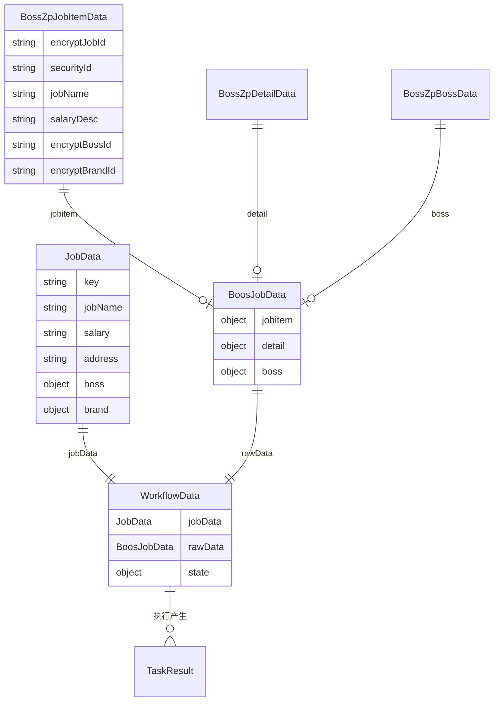
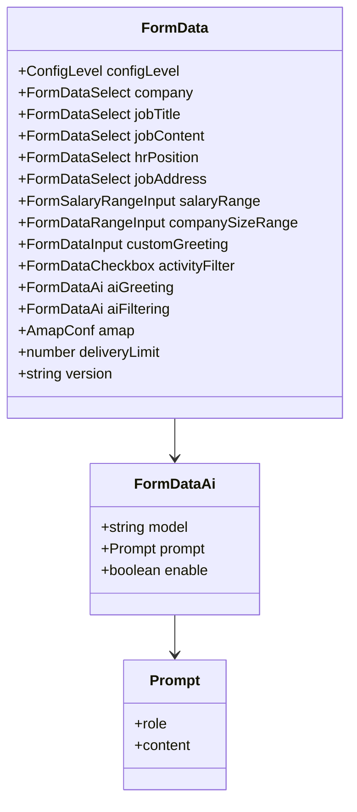

# 08 · 数据模型

本文按“从页面到工作流再到存储”的顺序整理核心数据结构。类型定义分散在：

- `src/composables/useHelper/type.ts`：`JobData`、`Log`
- `src/entrypoints/boss/types.ts`：Boss 接口原始数据
- `src/composables/useApplying/type.ts`：`Task`、`WorkflowData`、`TaskResult`
- `src/types/formData.ts`：`FormData`、`Statistics`
- `src/types/pipelineCache.ts`：缓存
- `src/composables/useModel/index.ts` / `type.ts`：模型配置
- `src/composables/useHelper/netConf.ts`：远程配置

## 1. 数据流总图



## 2. 统一职位模型：`JobData`

`JobData` 是 UI 和工作流唯一认识的职位结构，屏蔽了 Boss 接口差异。

```ts
type JobBaseData = {
  key: string
  link?: string
  jobName: string
  positionName: string
  jobDescription: string
}

type JobData = JobBaseData & {
  experienceName: string
  degreeName: string
  salary: string

  city?: string
  address?: string
  addressCoords?: [number, number]

  showSkills: string[]
  activeTime?: number
  activeTimeStr?: string
  welfareList?: string[]

  jobLabels: string[]
  skills: string[]

  boss: {
    link?: string
    name: string
    title: string
    avatar: string
    certificated: boolean
    isHeadhunter?: boolean
    isFriend?: boolean
    isOnline?: boolean
    isCertificated?: boolean
  }

  brand: {
    link?: string
    name: string
    logo: string
    scale: string
    industry: string
    stageName?: string
    introduce: string
    labels: Array<any>
  }
}
```

示例：

```json
{
  "key": "boss::ee226d37...",
  "link": "https://www.zhipin.com/job_detail/ee226d37....html",
  "jobName": "前端开发工程师",
  "positionName": "前端开发工程师",
  "jobDescription": "负责公司核心业务的前端开发...",
  "experienceName": "3-5年",
  "degreeName": "本科",
  "salary": "15-25K",
  "address": "北京-朝阳区-望京",
  "addressCoords": [116.497128, 39.996527],
  "showSkills": ["Vue", "React", "TypeScript"],
  "jobLabels": ["3-5年", "本科"],
  "skills": ["Vue", "React", "TypeScript"],
  "activeTime": 1710067550000,
  "activeTimeStr": "今日活跃",
  "welfareList": ["五险一金", "年终奖"],
  "boss": {
    "link": "https://www.zhipin.com/boss_detail/4e3d3f84....html",
    "name": "张经理",
    "title": "技术总监",
    "avatar": "https://img.bosszhipin.com/...",
    "certificated": true,
    "isHeadhunter": false,
    "isFriend": false,
    "isOnline": true
  },
  "brand": {
    "link": "https://www.zhipin.com/gongsi/6d13c740....html",
    "name": "北京某某科技有限公司",
    "logo": "https://img.bosszhipin.com/...",
    "scale": "500-999人",
    "industry": "互联网",
    "stageName": "C轮",
    "introduce": "...",
    "labels": []
  }
}
```

### 2.1 从列表项转换

`convertBossZpJobItemToJobData()` 的映射（`src/entrypoints/boss/index.ts`）：

| `JobData` 字段 | 来源 |
| --- | --- |
| `key` | `` `boss::${item.encryptJobId}` `` |
| `link` | `https://www.zhipin.com/job_detail/${encryptJobId}.html` |
| `jobName` / `positionName` | `item.jobName` |
| `jobDescription` | 空字符串，详情获取后填充 |
| `experienceName` | `item.jobExperience || item.jobLabels?.[0] || '经验不限'` |
| `degreeName` | `item.jobDegree || '学历不限'` |
| `salary` | `item.salaryDesc` |
| `address` | `[cityName, areaDistrict, businessDistrict].filter(Boolean).join('-')` |
| `addressCoords` | `item.gps ? [longitude, latitude] : undefined` |
| `showSkills` / `skills` | `item.skills ?? []` |
| `jobLabels` | `item.jobLabels ?? []` |
| `activeTime` | `item.lastModifyTime` |
| `activeTimeStr` | 由 `formatActiveTime(activeTime)` 生成 |
| `welfareList` | `item.welfareList` |
| `boss.link` | `https://www.zhipin.com/boss_detail/${encryptBossId}.html` |
| `boss.name/title/avatar` | `bossName/bossTitle/bossAvatar` |
| `boss.certificated` | `item.bossCert > 0` |
| `boss.isHeadhunter` | `item.goldHunter === 1` |
| `boss.isFriend` | 固定 `false`（**未回填**） |
| `boss.isOnline` | `item.bossOnline ?? false` |
| `brand.link` | `https://www.zhipin.com/gongsi/${encryptBrandId}.html` |
| `brand.name/logo/scale/industry/stageName` | `brandName/brandLogo/brandScaleName/brandIndustry/brandStageName` |
| `brand.introduce/labels` | `''` / `[]` |

### 2.2 详情补充

点击职位卡片后，`onJobCardClick()` 用 `jobDetail` 补：

| 字段 | 来源 |
| --- | --- |
| `activeTime` | `detail.brandComInfo.activeTime` |
| `activeTimeStr` | `detail.bossInfo.activeTimeDesc` |
| `jobDescription` | `detail.jobInfo.postDescription` |
| `city` | `detail.jobInfo.locationName` |
| `address` | `detail.jobInfo.address` |
| `addressCoords` | `[detail.jobInfo.longitude, detail.jobInfo.latitude]` |
| `boss.isOnline` | `detail.bossInfo.bossOnline` |
| `boss.isCertificated` | `detail.bossInfo.certificated` |
| `brand.labels` | `detail.brandComInfo.labels` |
| `brand.introduce` | `detail.brandComInfo.introduce` |
| `brand.stageName` | `detail.brandComInfo.stageName` |

`detail.relationInfo.beFriend` 也可以用来判断好友关系，但当前代码没有使用它；这是 `friendStatus` 过滤器失效的一个可修复点。

## 3. Boss 原始数据

### 3.1 `BossZpJobItemData`

职位列表项，字段非常多，核心字段：

| 字段 | 说明 |
| --- | --- |
| `securityId` | 请求安全标识 |
| `encryptJobId` | 加密职位 id |
| `lid` | 日志/追踪 id，用于匹配详情 |
| `jobName` | 职位名 |
| `salaryDesc` | 薪资描述 |
| `jobLabels` | 经验/学历标签 |
| `skills` | 技能标签 |
| `jobExperience` / `jobDegree` | 经验/学历 |
| `cityName` / `areaDistrict` / `businessDistrict` | 地址层级 |
| `gps` | 经纬度 |
| `lastModifyTime` | 活跃时间戳 |
| `welfareList` | 福利 |
| `encryptBossId` / `bossName` / `bossTitle` / `bossAvatar` / `bossCert` | 招聘者 |
| `bossOnline` | 是否在线 |
| `goldHunter` | 是否猎头（0/1） |
| `encryptBrandId` / `brandName` / `brandLogo` / `brandScaleName` / `brandIndustry` / `brandStageName` | 公司 |
| `contact` | 是否已沟通 |

### 3.2 `BossZpDetailData`

详情接口/页面数据，核心结构：

```ts
{
  pageType: number
  selfAccess: boolean
  securityId: string
  sessionId: any
  lid: string
  jobInfo: {
    encryptId, encryptUserId, invalidStatus, jobName, positionName,
    locationName, experienceName, degreeName, salaryDesc,
    postDescription, address, longitude, latitude,
    showSkills, jobStatusDesc, ...
  }
  bossInfo: {
    name, title, tiny, large, activeTimeDesc,
    bossOnline, brandName, bossSource, certificated,
    avatarStickerUrl?
  }
  brandComInfo: {
    encryptBrandId, brandName, logo, stageName, scaleName,
    industryName, introduce, labels, activeTime, ...
  }
  oneKeyResumeInfo: {...}
  relationInfo: { interestJob, beFriend }
  appendixInfo: {...}
  atsOnlineApplyInfo: {...}
  certMaterials: [...]
}
```

### 3.3 `BossZpBossData`

`getBossData` 返回：

```ts
{
  data: {
    bossFreezeStatus, companyName, tinyUrl, title, mobileVisible,
    encryptJobId, regionCode, bothTalked, encryptBossId, warningTips,
    bossId, weixinVisible, mobile, securityId, bossPreFreezeStatus,
    weixin, curTime, isTop, name, hasInterview, bossSource
  }
  job: {
    jobName, salaryDesc, brandName, locationName, proxyJob, proxyType,
    jobSource, degreeName, lowSalary, highSalary, experienceName
  }
}
```

发送消息时用到：

- `data.bossId` → `stanza.uid`
- `data.bossSource` → `stanza.friendSource`
- `data.securityId` → 图片上传

### 3.4 `BoosJobData`

```ts
type BoosJobData = {
  jobitem: BossZpJobItemData
  detail: BossZpDetailData
  boss: BossZpBossData
}
```

> 注意拼写是 `BoosJobData`（少一个 `s`），不是 `BossJobData`。它在整个项目中作为 `HelperContext` 的 `T` 参数使用。

## 4. 工作流数据

### 4.1 `WorkflowData`

```ts
interface WorkflowData<T, S> {
  jobData: JobData
  rawData: T
  state: WorkflowState & Partial<S>
}

interface WorkflowState {
  amap?: {
    geocode?: Awaited<ReturnType<typeof amapGeocode>>
    distance?: Awaited<ReturnType<typeof amapDistance>>
  }
}
```

- `jobData`：统一模型，UI 用
- `rawData`：站点原始数据，筛选/投递/发消息用
- `state`：任务之间共享的临时状态（当前 `stateMaps` 没有写入路径，实际是每次执行新建的空对象）

### 4.2 `TaskResult` / `JobStatus`

```ts
type JobStatus =
  | 'pending' | 'wait' | 'running' | 'request' | 'ai'
  | 'success' | 'warn' | 'error'

type TaskResult = {
  isSkip?: boolean
  reason?: string
  status?: JobStatus
  msg?: string
  isCache?: boolean
  id?: string
}
```

状态在 UI 中的颜色（`JobCard.vue`）：

| 状态 | 颜色 | 含义 |
| --- | --- | --- |
| `pending` / `wait` | `#CECECE` | 等待 |
| `running` | `#98F5F9` | 运行中 |
| `request` | `#3498db` | 请求详情 |
| `ai` | `#9b59b6` | AI 处理 |
| `success` | `#2ecc71` | 成功 |
| `warn` | `#f39c12` | 被过滤/警告 |
| `error` | `#e74c3c` | 错误 |

### 4.3 `jobResultMaps`

```ts
helper.jobResultMaps: Reactive<Map<string, TaskResult>>
```

key 是 `JobData.key`，value 是当前结果。驱动：

- 卡片状态颜色/文案
- 下一轮是否跳过
- 统计

## 5. 统计模型

```ts
interface Statistics {
  date: string          // YYYY-MM-DD
  success: number
  total: number
  repeat: number
  activityFilter: number
  tasks: {
    [taskId: string]: {
      [status: string]: number
    }
  }
}
```

示例：

```json
{
  "date": "2026-10-27",
  "success": 37,
  "total": 126,
  "repeat": 0,
  "activityFilter": 18,
  "tasks": {
    "已沟通": { "warn": 6 },
    "岗位名": { "warn": 11 },
    "AI筛选": { "warn": 23, "success": 37 },
    "岗位投递": { "success": 37 }
  }
}
```

## 6. 配置模型

见 [05-配置系统.md](./05-配置系统.md)。这里只列关系：



`FormData` 有 `[key: string]: any` 索引签名，这带来便利也带来类型风险：拼错字段名不会报错，运行时会得到 `undefined`。

## 7. AI 模型数据

```ts
interface ModelConf {
  key: string
  name: string
  color?: string
  data?: OpenaiLLMConf
}
```

`OpenaiLLMConf` 见 [06-AI能力.md](./06-AI能力.md#1-模型配置的数据结构)。

会话消息：

```ts
interface Message extends ChatMessageProps {
  uiRole: 'system' | 'user' | 'assistant' | 'boss' | 'jd' | 'filtering' | 'greetings'
}
```

`VueChatState.messages` 是 AI SDK 的 `UIMessage[]`，`parts` 中可能是：

- `{ type: 'text', text, state }`
- `{ type: 'reasoning', text, state }`
- tool part（当前没有工具调用）

## 8. 缓存模型

```ts
type ProcessorType = 'aiFiltering' | 'amap' | 'basic'

interface PipelineCacheItem {
  encryptJobId: string
  jobName: string
  brandName: string
  status: JobStatus
  message: string
  expireAt: number
  createdAt: number
  lastAccessed: number
  hitCount: number
  processorType: ProcessorType
}

interface PipelineCache {
  data: Record<string, PipelineCacheItem>
  lastCleanup: number
}
```

存储键：`local:pipeline-cache`。当前未接入投递流程。

## 9. 去重集合模型

`local:sameCompany` / `local:sameHr`：

```json
{
  "4e3d3f84...": {
    "boss::ee226d37...": 1710067550000,
    "boss::aa11bb22...": 1710067650000
  }
}
```

- 外层 key：用户 `encryptUserId`
- 内层 key：`JobData.key`（`boss::<encryptJobId>`）
- value：写入时间戳，用于过期 GC

`loadSet` 兼容两种历史格式：

- 数组：`{ uid: ["id1", "id2"] }` → 时间戳按 0 处理
- 对象：`{ uid: { "id1": ts } }`

## 10. 日志模型

```ts
interface Log {
  job?: JobData
  title: string
  state: 'info' | 'success' | 'warning' | 'danger'
  state_name: string
  message?: string
  data?: LogData
}

interface LogData {
  jobData: JobData
  el?: Element
  amap?: {...}
  bossData?: BossZpBossData
  message?: string
  state?: string
  err?: string
  aiFilteringQ?: string
  aiFilteringR?: string | null
  aiFilteringAjson?: object
  aiFilteringAtext?: string
  aiGreetingQ?: string
  aiGreetingR?: string | null
  aiGreetingA?: string
}
```

`HelperContext.logs` 是一个“扩展了方法的 ref”：

```ts
logs = extendRef(_logs, {
  add(job, err?, logdata?, msg?) {...},
  info(title, message) {...},
  clear() {...}
})
```

`LogData` 中很多 AI 字段当前没有写入点，属于预留。

## 11. 远程配置模型

```ts
interface NetConf {
  version: string
  version_description?: string
  notification: (NotificationAlert | NotificationNotification)[]
  store?: Record<string, [string, string, string]>
  price_info?: { signedKey: number; account: number; update_time: string }
  feedback: string
}
```

`store` 的三元组含义（结合 `Version.vue`）：

1. 描述文本
2. 跳转 URL
3. 徽章图片 URL

## 12. 类型层面的注意点

| 点 | 说明 |
| --- | --- |
| `BoosJobData` 拼写 | 少一个 `s`，搜索时注意 |
| `meginResults` 拼写 | `mergeResults` 的笔误 |
| `JobData.key` 语义 | 是职位 id，不是公司/HR id，影响去重逻辑 |
| `FormData` 索引签名 | 字段写错不会编译报错 |
| `certificated` vs `isCertificated` | 列表项用前者，详情补充用后者，两者可能不一致 |
| `isFriend` 未回填 | 好友过滤实际无效 |
| `stateMaps` 未写入 | 工作流 `state` 只在单次 `execute` 内有效 |
| `JobStatus` 顺序 | `error > warn > success`，合并结果时依赖这个顺序 |
| `Task.id` 中文 | 既是 id 也是日志/统计 key，改名会影响历史统计数据 |

下一篇：[09-开发与调试.md](./09-开发与调试.md)。
